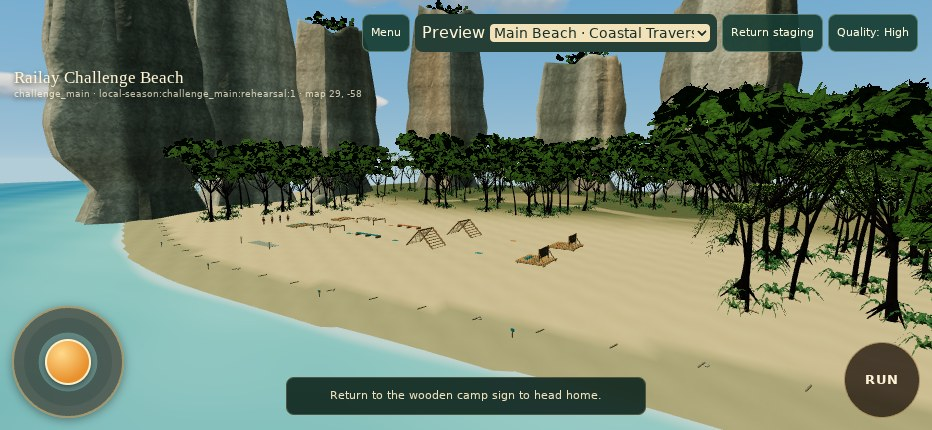
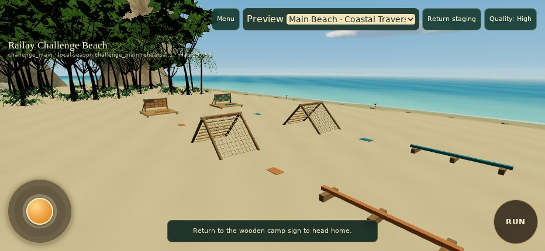
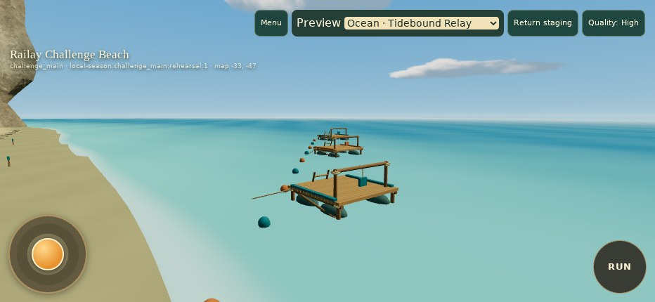
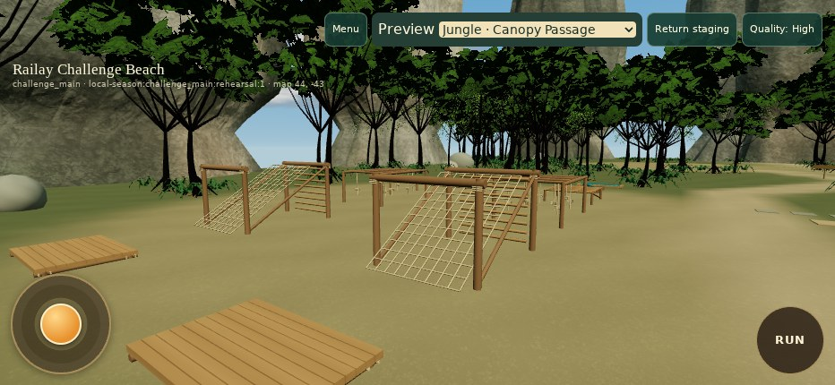
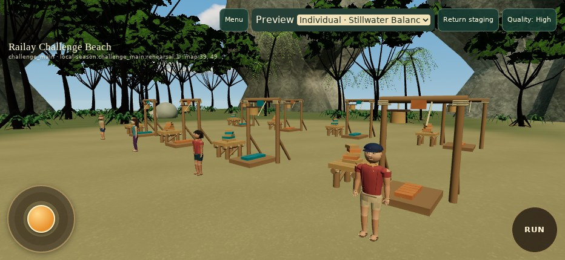

# Actual Challenge Beach WebGL gallery

**Sixteen real captures** from the successful [runtime verification](https://github.com/sunsetseast/SurvivorIsland3Dprototype/actions/runs/42068507831), runtime commit `831e47400c06f120fa7d73791ba2eea4d8cfbe40`. Original 932 × 430 JPEGs are committed in [evidence](evidence/). [File hashes and provenance](evidence/PROVENANCE.json) · [Raw browser report](evidence/browser-report.json).

These are running-game images, not generated concept art. Inspection cameras show the real scene from useful review angles; they do not demonstrate swimming, climbing or interactive challenge gameplay. Normal Player views are labeled below. All 16 repository image hashes match the captures inspected before the local workspace became unavailable.

## High quality capture index

| Capture | View | Camera / scope |
| --- | --- | --- |
| [01-arrival-high.jpg](evidence/01-arrival-high.jpg) | Arrival and player spawn | Normal Player camera |
| [02-main-beach-panorama.jpg](evidence/02-main-beach-panorama.jpg) | Main beach panorama | Developer inspection camera over the same world |
| [03-main-obstacle-course.jpg](evidence/03-main-obstacle-course.jpg) | Main obstacle course | Developer inspection |
| [04-ocean-area.jpg](evidence/04-ocean-area.jpg) | Ocean competition area | Developer inspection |
| [05-floating-platforms.jpg](evidence/05-floating-platforms.jpg) | Anchored floating platforms | Developer inspection; offshore player movement remains disabled |
| [06-jungle-trail.jpg](evidence/06-jungle-trail.jpg) | Jungle trail | Normal Player camera |
| [07-jungle-clearing.jpg](evidence/07-jungle-clearing.jpg) | Jungle competition clearing | Developer inspection |
| [08-rope-and-net-course.jpg](evidence/08-rope-and-net-course.jpg) | Rope-and-net course | Developer inspection |
| [09-individual-arena.jpg](evidence/09-individual-arena.jpg) | Individual arena | Developer inspection |
| [10-balance-stations.jpg](evidence/10-balance-stations.jpg) | Balance/endurance/stacking stations | Developer inspection |
| [11-limestone-and-coast.jpg](evidence/11-limestone-and-coast.jpg) | Limestone and curved coastline | Developer inspection |
| [12-player-camera-traversal.jpg](evidence/12-player-camera-traversal.jpg) | Player-camera traversal | Normal Player camera after trusted keyboard movement |

## Four selected models

## Low quality comparisons

The same four fixed inspection poses were rendered in both quality modes; [performance measurements](PERFORMANCE.md) record the geometry difference.

| Setup | Low capture | High capture |
| --- | --- | --- |
| Main Beach | [Low](evidence/low-beach-obstacle.jpg) | [High](evidence/03-main-obstacle-course.jpg) |
| Ocean | [Low](evidence/low-ocean-relay.jpg) | [High](evidence/04-ocean-area.jpg) |
| Jungle | [Low](evidence/low-jungle-net.jpg) | [High](evidence/07-jungle-clearing.jpg) |
| Individual | [Low](evidence/low-individual-balance.jpg) | [High](evidence/09-individual-arena.jpg) |

Visual review corrected an obstructed panorama, regular water striping, insufficient ground/understory detail and pointed karst crowns. The final reviewed captures show clear circulation around equipment, supported structures, continuous terrain/coast and no visible terrain gaps or unsupported/hovering structures in the inspected views; offshore decks rest on modeled flotation. Physical iPhone/Safari visual and interaction acceptance remains a manual step.
