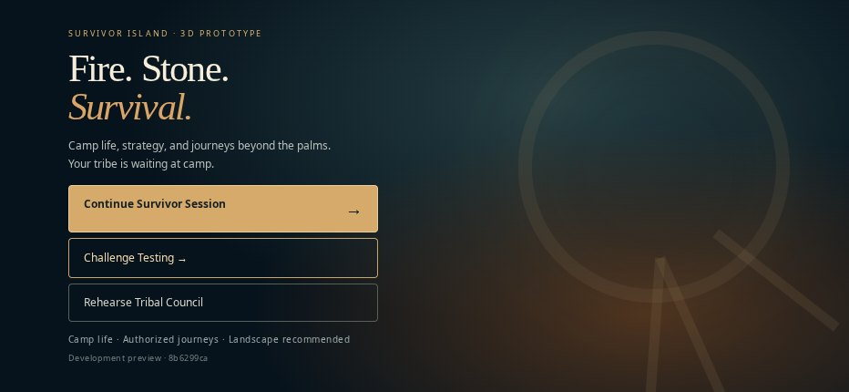
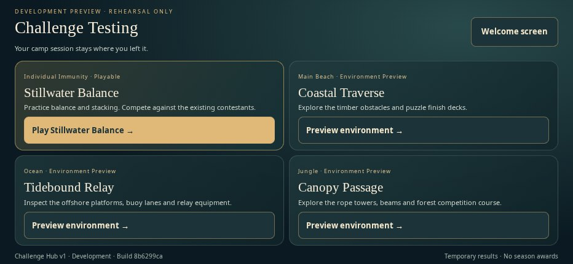
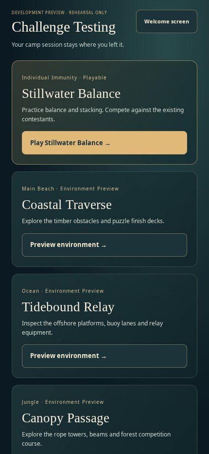
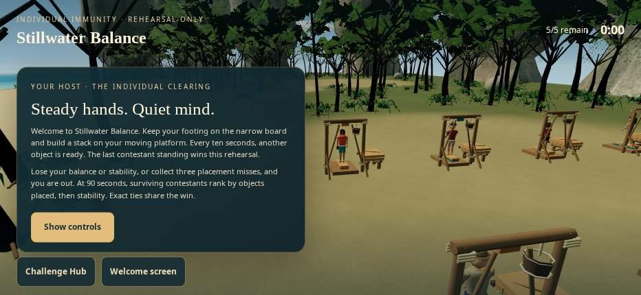
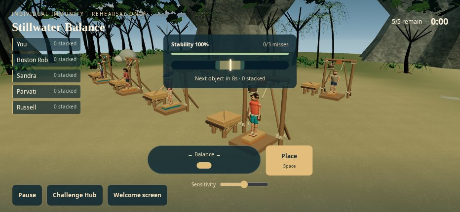
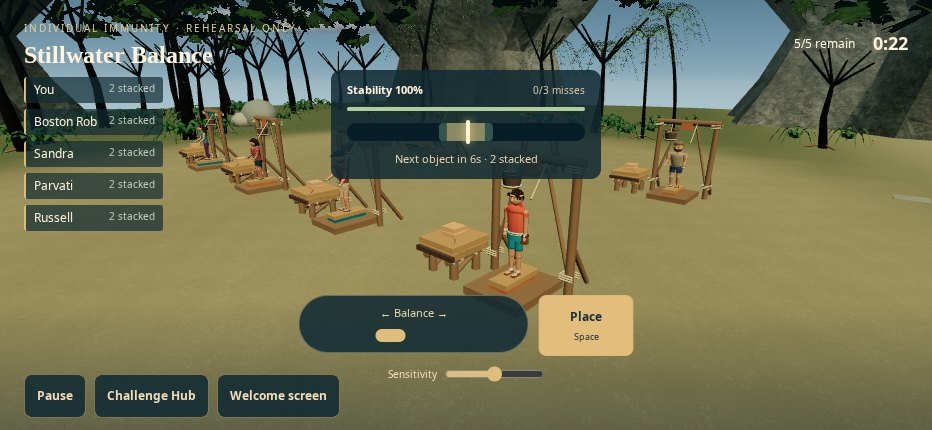
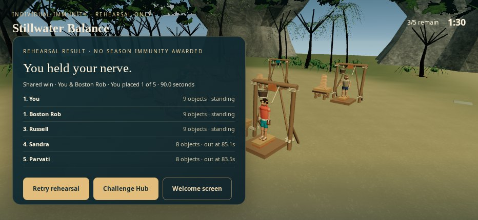

# Running application evidence

Actual application screenshots from local Chromium software WebGL with trusted touchscreen/CDP input. No generated mockups, physical iPhone or live hosted-preview claim. Source bytes are recorded in [source-manifest.json](evidence/source-manifest.json); [raw checks and results](evidence/browser-report.json).

The welcome/hub footer shows local parent revision `8b6299ce`, captured before the checkpoint's GitHub metadata save. The exercised source bytes match runtime checkpoint `c1a940de627ebd8f349242066893063cab3081f7`; local and remote commit metadata differ because authenticated Git-data operations saved identical file trees. Documentation-only saves retain this source manifest.

## Welcome and selection

## Real competition

