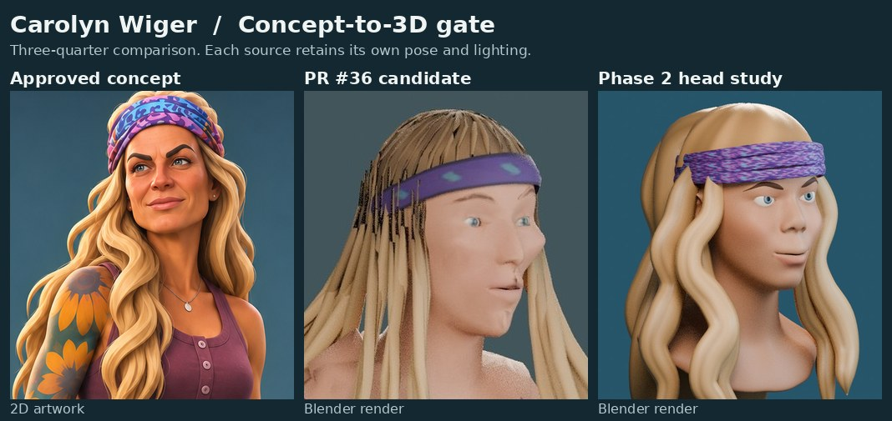

# Carolyn Wiger · Concept-to-3D head study

The target is the developer-approved stylized Carolyn concept. The [Survivor 44 photo board](../character-art-bible/references/17-carolyn-wiger.md) and [character specification](../character-art-bible/characters/17-carolyn-wiger.md) guide likeness and season details. The concept supplies one view. It also interprets the tattoo artwork. Any future body pass should follow the Art Bible's verified placement and keep unresolved motifs out of production.

## Zero-cost methods

| Approach | Facial, groom and wardrobe control | Editability, rig and mobile | License and availability |
| --- | --- | --- | --- |
| Manual Blender from scratch | Direct control of every face plane, hair mass and fitted garment. Highest sculpt and retopology effort. | Can build expression loops and weight-ready topology deliberately. Export standard PBR through glTF. Needs groom reduction and device checks. | Blender 4.3.2 installed and renders locally on CPU. |
| Local TripoSR | Single-image reconstruction can approximate visible form. The profile, rear and occluded shapes are inferred. Eye and mouth loops, separate hair and clothing need reconstruction. | Editable mesh and optional UV texture bake. Retopology, material cleanup and skinning still needed before Blender export to Three.js. | MIT code and weights. Upstream reports about 6 GB VRAM for defaults. No CUDA GPU is present here. CPU inference was outside this test. [TripoSR](https://github.com/VAST-AI-Research/TripoSR#manual-inference) |
| Blender hybrid, tested | Start from standalone animation head topology. Shape Carolyn's face and expression, fit separate eyes and build the long groom in independent layers. For a later body, sculpt fitted garments and paint details on separate UVs. | Continuous facial loops survive the sculpt. Separate meshes and sculpt layers remain editable. Would require facial pose checks, skinning, baked material detail, simplified hair and a physical-device budget. | Blender Studio Human Base Meshes v1.4.1 is CC0. The exact bundle and selected head loaded locally. [Blender Studio bundle](https://www.blender.org/download/demo-files/#assets) |
| MPFB | Good for a parametric body foundation and rig setup. Likeness, hairstyle and signature clothing still need separate artist work. | Editable Blender topology and auto rigs. Any weights need mapping to the shipping skeleton. Optimize topology and materials before glTF. | GPL add-on with CC0 core assets. Optional assets have their own licenses. Compatible with Blender 4.2 and later, including the installed version. It was not installed for this test. [MPFB extension](https://extensions.blender.org/add-ons/mpfb/) · [License](https://github.com/makehumancommunity/mpfb2/blob/master/LICENSE.md) |

The [Blender glTF exporter](https://docs.blender.org/manual/en/latest/addons/import_export/scene_gltf2.html) supports skins, animation and standard PBR inputs. Review shaders and subdivided geometry in this file are studio assets. Runtime equivalents need a separate export and verification pass.

## Visual gate · FAIL



[Front, three-quarter and profile comparison](evidence/blender-angles.jpg) · [Original PR #36 face board](https://github.com/sunsetseast/SurvivorIsland3Dprototype/blob/6e43d0d2072d5cff8945babc42c6d6050d65682d/docs/character-benchmarks/evidence/carolyn-face.jpg) · [PR #36 body board](https://github.com/sunsetseast/SurvivorIsland3Dprototype/blob/6e43d0d2072d5cff8945babc42c6d6050d65682d/docs/character-benchmarks/evidence/carolyn-body.jpg)

The new panels are Cycles renders from one editable Blender scene under fixed studio lights. The prior panels come from the rejected PR #36 candidate row. The old and new scenes have different lighting, pose and framing. The approved concept provides one three-quarter view. It was cropped for review without fabricating front or profile views.

| Area | Review |
| --- | --- |
| Overall appeal and likeness | The new brow asymmetry and fuller hair make a more legible stylized bust. The face reads younger and more generic than the concept, especially from the front. The concept's cheekbones, compressed lower face and expressive squint are central to the likeness. |
| Brows, eyes, nose, mouth and chin | The revision reseated the eyes into the actual orbital loops and narrowed the lid openings. The exposed sclera and weak lower-lid contour still give the eyes a doll-like stare. The bridge and tip read as an unbroken curve in profile, the chin and cheeks are too soft, and the small smile lacks the concept's lip asymmetry and cheek tension. |
| Hair and materials | Wider, irregular waves improve on #36's narrow separated ribbons. The crown correction removed exposed scalp and reduced the root discontinuity in front. The profile still shows intersections at the Buff, hard separations at the crown and overly uniform highlights. Skin is less flat under studio light but still misses the concept's plane definition and warm color variation. The Buff pattern is a color study. |
| Wardrobe and build | PR #36 has the plum top, dark shorts, waist-tied grid shirt, bare feet and asymmetric ink. The concept uses those same clothing cues and a more articulated sleeve illustration. The Phase 2 model is a bust, so wardrobe fit, tattoo fidelity and full-body proportions remain outside the result. |
| Animation and device readiness | PR #36 already demonstrated a 66-joint, 13-clip game path. The new study preserves editable face loops but has no armature, pose verification, game export or Safari measurements. Its 452,130 evaluated studio triangles are above a reasonable head budget for the existing mobile cast. |

**Decision.** The tested scripted sculpt on the CC0 head failed the likeness gate. Work stopped at the bust. Blender can represent the approved design, but this experiment has not shown a repeatable way to author that likeness at the required quality.

**Next step.** Use the standalone topology for one hands-on Blender sculpt review. Work in clay with the groom hidden and match the eyelid planes, cheekbones, nose profile and mouth corners against the Survivor 44 front and side references. Review a blink and relaxed smile at close range, then recheck with a fitted scalp and layered hair. Only an approved result should move to clothing, the existing deform rig and a physical iPhone Safari test.

## Open or rebuild

Open [carolyn-head.blend](carolyn-head.blend) in Blender 4.3.2. The three review cameras are saved in the scene. The head has separate shape keys for face planes and expression. Eyes, brows, Buff and groom are separate objects. The file was reopened headlessly and checked for all three cameras, both authored shape keys, 3,242 base head vertices, zero non-manifold head edges and no external image dependencies.

[author.py](author.py) reproduces the study from the official CC0 bundle. ZIP SHA-256 `811f43accbb31a88266d932f8f5563b2d13586fca0ba2693aad1f5fe582b3515`.

```sh
blender -b -t 8 --python-exit-code 1 --python docs/character-carolyn-head/author.py \
  -- /path/to/human_base_meshes_bundle.blend /tmp/carolyn-head
```
