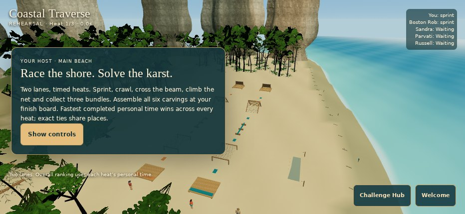
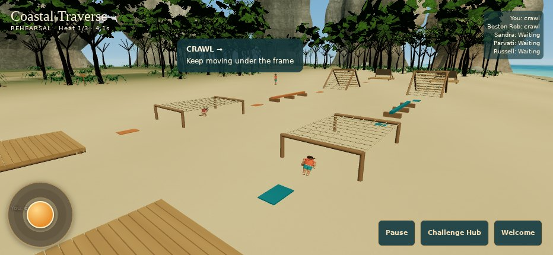
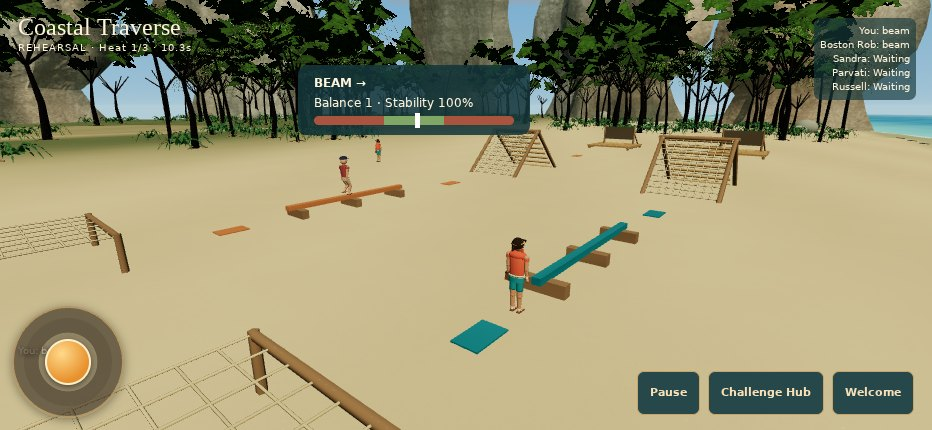
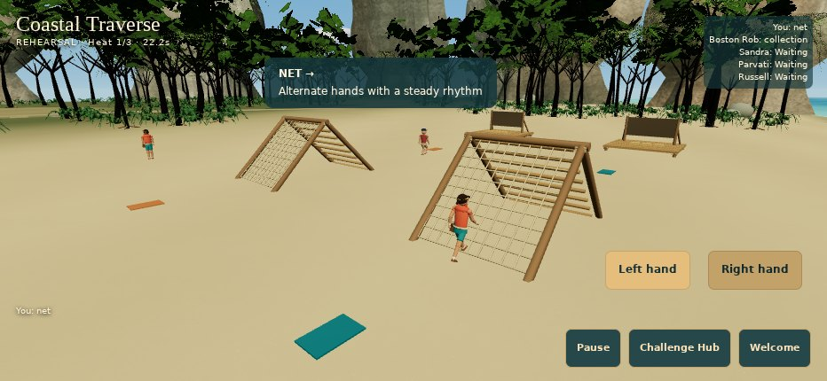
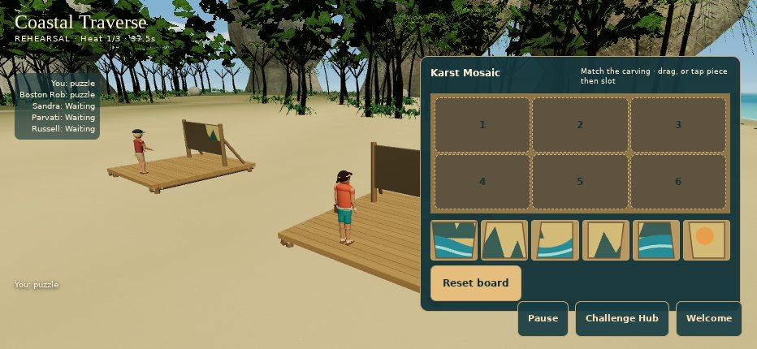
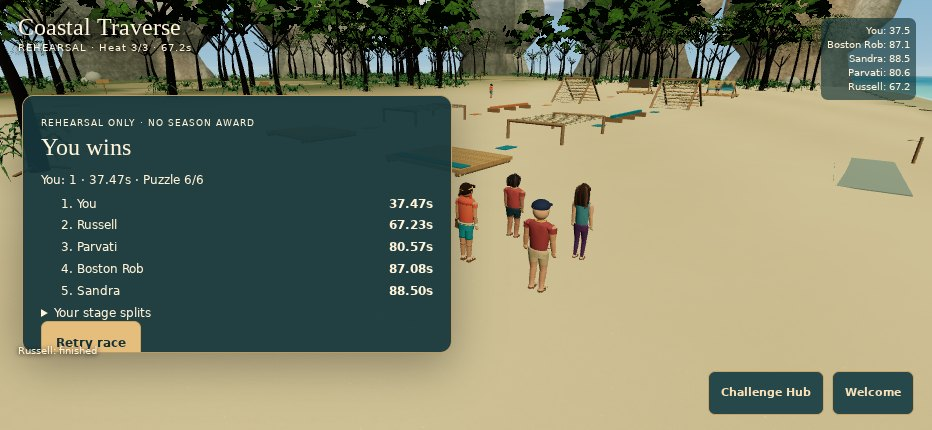
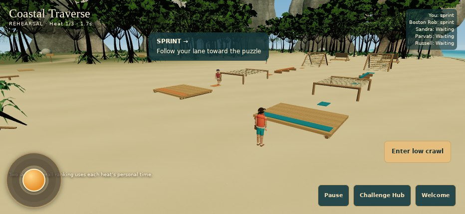

# Actual WebGL evidence

These are the running application's GitHub CI screenshots at source `72cf39eb8bbac8af83ae57ae95e973bf17898722`, Chromium 156 software WebGL, mobile 932×430 DPR1. Archive SHA-256: `164b6f28ba701a14ffe174a76cb646176f74b2f99983212442e036b3716eac3f`. No generated mockups or physical iPhone claim. [Raw report](evidence/browser-report.json).

