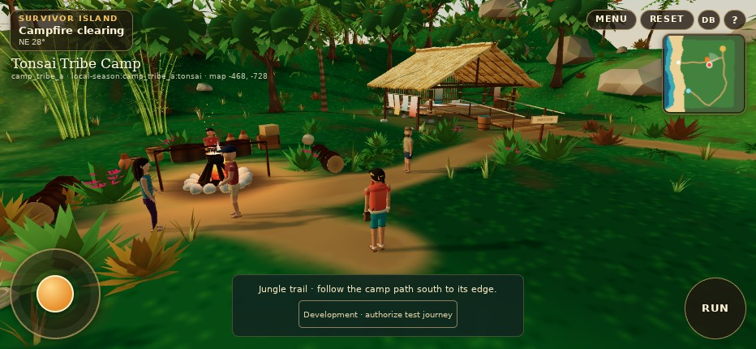
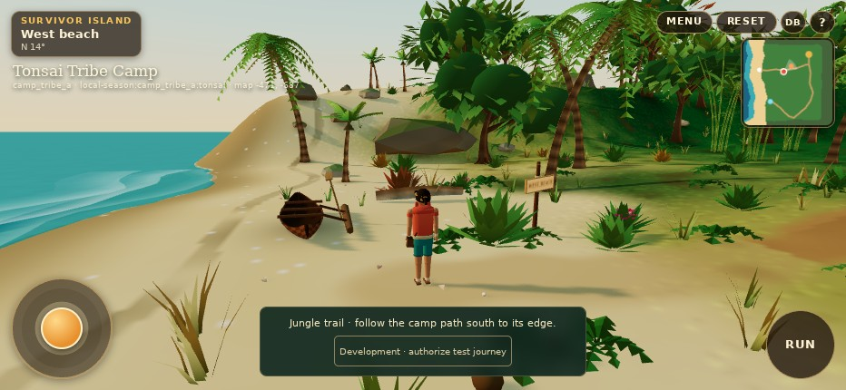
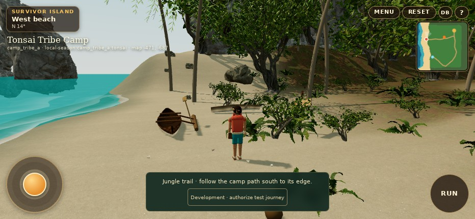
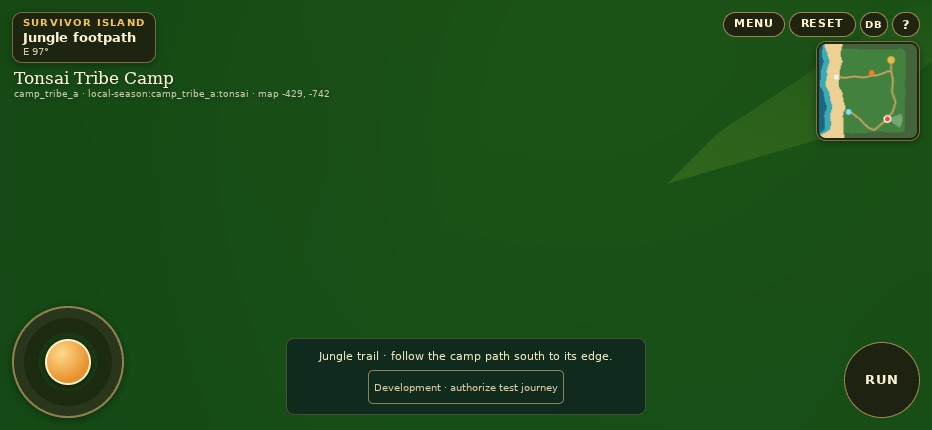
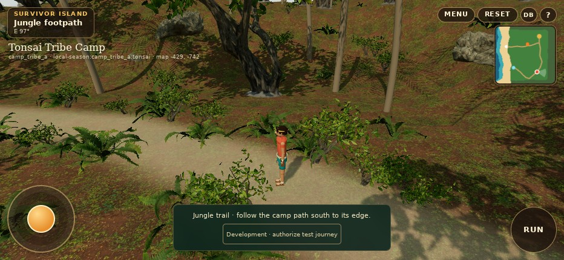
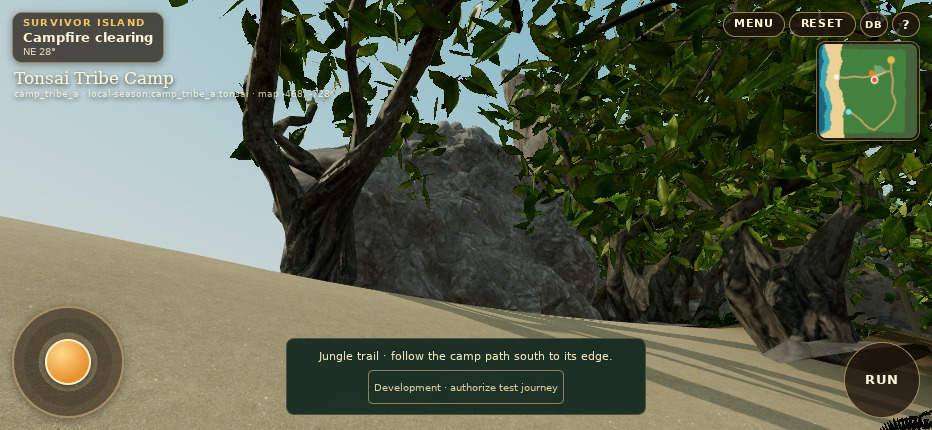
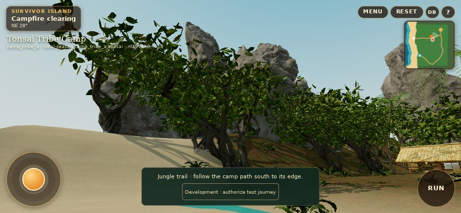

# Actual WebGL evidence

All frames are from the running Three.js game in Chromium 156 / ANGLE SwiftShader at 932 × 430, DPR 1. They are not Blender renders or generated concept images. Development travel controls are visible in some captures. The main set uses the actual Player camera, body, terrain and NPC scene. See the raw [before](evidence/before/report.json), [after](evidence/after/report.json), [journey](evidence/journeys/browser-report.json) and [multitouch](evidence/multitouch/report.json) reports.

## Matched before / after

These pairs use the same player position, yaw, pitch and viewport. NPC activity can progress during different loading times. Only the default Camp pair is used for the performance comparison; the extra art-inspection cameras below are not equivalent benchmarks.

| Original main | Reconstructed Camp |
| --- | --- |
|  |  |
|  |  |
|  |  |

## Player-camera review

| Requirement | Actual frame |
| --- | --- |
| Main Camp overview | [Standing third-person view](evidence/after/high-01-main-camp.jpg) |
| Campfire and shelter | [Fire, cooking space, shelter and route](evidence/after/high-02-fire-shelter.jpg) |
| Beach toward cliffs | [Beach, palms and northern headland](evidence/after/high-03-beach-cliffs.jpg) |
| Close approach toward limestone | [Native boom view through understory](evidence/after/high-04-limestone-close.jpg) — retained even though the tree and slope obstruct much of the rock |
| Canopy | [Branching and foliage at normal player height](evidence/after/high-05-canopy.jpg) |
| Jungle floor | [Litter, ferns, roots and worn path](evidence/after/high-06-jungle-floor.jpg) |
| Beach-to-jungle transition | [Continuous material transition](evidence/after/high-07-beach-jungle.jpg) |
| Water and shoreline | [Shore, foam and shallow-water approximation](evidence/after/high-08-water.jpg) |
| NPCs in Camp | [Gathering](evidence/after/high-09-npcs.jpg) and [real dialogue after repeated journeys](evidence/journeys/11-camp-conversation.jpg) |
| Private conversation space | [Reachable quiet beach](evidence/after/high-10-private-beach.jpg) |
| Departure path | [Natural forest departure](evidence/after/high-11-departure.jpg) and [authorized interaction](evidence/journeys/03-authorized-interaction.jpg) |
| Running | [Actual Run state and moving rig](evidence/after/high-12-running.jpg) |
| Low mobile profile | [Same Camp pose on low](evidence/after/low-01-main-camp.jpg), [low beach](evidence/after/low-03-beach-cliffs.jpg), [low jungle](evidence/after/low-06-jungle-floor.jpg) |
| High profile | [Same Camp pose on high](evidence/after/high-01-main-camp.jpg) |
| Simultaneous touches | [Joystick + camera + Run](evidence/multitouch/05-three-touch-running-and-look.jpg) |
| Connected world | [Real trail arrival](evidence/journeys/05-trail-arrival.jpg), [return interaction](evidence/journeys/07-return-connection.jpg), [restored Camp](evidence/journeys/09-restored-camp.jpg) |
| Tribal regression | [Sanctuary](evidence/journeys/12-tribal-council.jpg) and [deposited practice ballot](evidence/journeys/13-tribal-voting.jpg) |

## Additional eye-height rock inspection

These two extra frames use the **actual WebGL scene** with diagnostic cameras 1.65 m above verified playable sand, aimed upward at the rock. They are explicitly separate from Player's follow camera. Their exact eyes/targets are recorded in [the inspection report](evidence/inspection/report.json).

## Remaining defects and failure behavior

The [close native camera](evidence/after/high-04-limestone-close.jpg) exposes slope/foliage obstruction and scan root skirts. [Jungle floor](evidence/after/high-06-jungle-floor.jpg) exposes material repetition and sparse patches. [Shoreline](evidence/after/high-08-water.jpg) exposes the inexpensive water/foam approximation. The additional rock views show the remaining boulder-derived silhouette and repeated tree forms. These are retained rather than hidden by aerial-only views.

[Missing-model fallback](evidence/after/failure-degraded.jpg) deliberately aborts all four model requests. Primitive fallback art is a recovery state, **not the accepted normal environment**; the test verifies that loading clears and movement works. [Aborted journey module](evidence/journeys/14-network-load-failure.jpg) demonstrates the existing safe-return flow.

The historical iPhone diagonal is not reproduced in this evidence set, so this gallery cannot certify its original cause or device-specific resolution.

## Rejected first pass

The first open rock scan and overly reduced canopy failed the visual review. These screenshots are **not the final art**:

- [Open/slab-like cliff scan and dark sand](evidence/iterations/rejected-1-high-03-beach-cliffs.jpg)
- [Sparse canopy and exposed slopes](evidence/iterations/rejected-1-high-05-canopy.jpg)
- [First-pass measurements](evidence/iterations/rejected-1-report.json)
