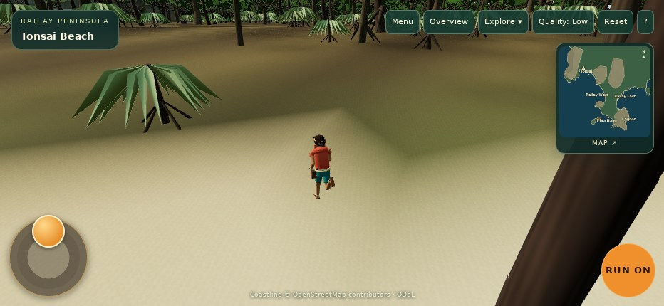

# PR #13 — iPhone sprint and two-thumb controls

**Implemented and browser-verified; physical iPhone Safari still requires device confirmation.** Based on main `4fc54f4e22e9090a7f0b6ac43c3198312b515e10`, including merged Tonsai PR #12. Draft only; no deployment or merge.

## Root cause

Two independent failures reproduced on unchanged main with real Chromium touch input:

1. **Run was click-only.** While the joystick finger remained down, the second finger generated trusted `pointerdown` and `pointerup` on Run, but no compatibility `click`. The sprint toggle never activated. See [baseline multitouch event log and failing assertion](evidence/baseline-multitouch/report.json).
2. **Joystick release wrote `input.run = false`.** Enabling Run before moving worked until the joystick finger lifted. That silently canceled the toggle; the polling HUD could briefly display the old state. See [isolated release regression](evidence/baseline-release/report.json).

Run cancellation also cleared the latch independently, and joystick cleanup wrote camera state. These crossed control ownership boundaries. The existing inherited pointer-events fix was present; controls now explicitly opt into hit testing as well.

## Implementation

- Run and HUD action buttons activate once on a completed, owned pointer tap. Secondary/third fingers work without a compatibility click. Native keyboard/assistive clicks remain supported; canceled/dragged taps do not toggle.
- One authoritative `input.run` latch publishes changes to `useSyncExternalStore`, including existing explicit reset writers. No visual latch or polling timer.
- Joystick owns direction/pressure; Run owns sprint; orbit owns look. Each retains one pointer ID and releases capture on reset/unmount. Window movement/release fallbacks retain ownership when capture retargeting is unavailable; this was exercised by WebKit dragging beyond the circular joystick.
- Map/help lock Railay movement, including keyboard input. Reset, focus loss, scene exit, conversations and entry into locked states clear the appropriate inputs and invalidate old contacts.
- Main-menu and ceremony action buttons use the same tap handling, so returning from multitouch gameplay does not depend on a suppressed click.
- Walking **3.25 m/s**, running **6.4 m/s**, pressure normalization, movement basis, collision/camera math and animation choreography remain unchanged. The named player group exposes nonvisual locomotion telemetry for QA.

No terrain, cliffs, vegetation, lighting, materials, geography, assets or Blender scripts changed. `SurvivorIsland2025` was not modified.

## Measured gameplay

Both engines ran the actual app at **932 × 430**, touch enabled, low quality, with real WebGL. Inspector-injected contacts produced browser-trusted pointer events. Run, joystick and look state were never assigned by the test. Teleports and camera-sweep setup are diagnostic fixtures using the real terrain/collision solver.

| Measurement | Chromium 153 | WebKit 27.2 |
| --- | ---: | ---: |
| Settled walking speed | 3.250 m/s | 3.250 m/s |
| Walking displacement over 60 simulated frames | 3.250 m | 3.250 m |
| Settled running speed | 6.400 m/s | 6.400 m/s |
| Running displacement over 60 simulated frames | 6.400 m | 6.400 m |
| Speed ratio | 1.969× | 1.969× |
| Run after joystick release | true | true |
| Stationary actual speed / running animation flag | 0 / false | 0 / false |
| Full browser test groups | 16 passed | 16 passed |

Walking: `(x,z) = (-670,-823.00535) → (-670,-826.25535)`.
Running: `(-670,-832.47239) → (-670,-838.87239)`.
These are measured horizontal displacement, after acceleration, on open Tonsai ground. The reports contain all directions, positions, actual speeds, input values, camera state, animation inputs and real rig transforms.

Verified: RUN/RUN ON activation/deactivation; all eight sprint directions; normalized diagonals and mixed keyboard/stick maximum; release and sprint restart; walk/run/slow/idle rig transitions; Shift and keyboard button activation; joystick + Run + orbit; rapid turns with a stable movement basis; extra fingers rejected; canceled/dragged/rapid taps; native touch cancellation; map/reset/blur with fingers down; stale contacts ignored; scene exit/reentry; Camp and permitted Tribal Council movement. The Tonsai sweep actually shortened the camera boom at a blocker. No page scroll occurred; both controls hit-tested correctly with edge margins.

Native cancellation and the control interactions use trusted browser input. One **additional, explicitly synthetic DOM `pointercancel`** isolates Run while joystick and look remain held; it supplements the native cancellation test. Focus loss is dispatched as a lifecycle test. No physical interruption or Safari session is claimed.

## Validation and evidence

- **79 unit tests passed**, application TypeScript passed, production build passed. The existing large-chunk build warning remains; these local checks passed.
- Existing Camp WebGL suite: **6 check groups passed**, conversations/approaches/routes and portrait views; zero recorded errors. [Raw report](evidence/camp-regression.json).
- Existing Tribal Council WebGL suite: **71 checks passed**, including practice ballot, voting camera, ceremony and navigation; zero recorded errors. [Raw report](evidence/tribal-regression.json).
- [Chromium structured report](evidence/report.json) · [WebKit structured report](evidence/webkit/report.json) · [unit output](evidence/unit-tests.txt) · [build output](evidence/build.txt).
- [Walking](evidence/02-walking.jpg) · [Running](evidence/03-running.jpg) · [Idle with Run latched](evidence/04-idle-run-latched.jpg) · [Three simultaneous contacts](evidence/05-three-touch-running-and-look.jpg) · [Camp](evidence/regression-camp.jpg) · [Tribal Council](evidence/regression-tribal.jpg). Corresponding WebKit captures are in [its evidence directory](evidence/webkit).



## GitHub CI and pre-existing failure

The [new mobile-controls workflow](https://github.com/sunsetseast/SurvivorIsland3Dprototype/actions/runs/40661269952) passed on code commit `86c6d9f`, including both browser suites, TypeScript, all 79 unit tests and the build.

**The legacy Tonsai workflow remains red for a confirmed pre-existing test timeout.** Its [PR #12 run](https://github.com/sunsetseast/SurvivorIsland3Dprototype/actions/runs/40654824232) and [this PR's run](https://github.com/sunsetseast/SurvivorIsland3Dprototype/actions/runs/40661269920) both fail after 180 seconds at `scripts/hero-gameplay-qa.mjs:318:14`. That wait requires at least two textures with image width exactly 512 after returning to Railay. It is an asset-specific readiness check, after the movement/touch assertions. Neither the legacy script nor environmental assets were changed here. The legacy workflow consequently skipped its later loading/environment steps. [CI comparison and exact error excerpts](evidence/ci-status.json).

The [existing Living Camp workflow](https://github.com/sunsetseast/SurvivorIsland3Dprototype/actions/runs/40661269824) also passed in full, including Camp, characters, Tribal Council, assets and standalone packaging. The legacy Tonsai readiness timeout is the only red workflow.

## Reproduction and limits

From the repository root, with Node 24 and pnpm 11.25.0:

```sh
pnpm install --frozen-lockfile --ignore-scripts --config.strict-dep-builds=false
pnpm exec tsc -b lib/api-client-react
pnpm --filter @workspace/survivor-camp-prototype typecheck
pnpm --filter @workspace/survivor-camp-prototype test
PORT=5174 BASE_PATH=/ pnpm --filter @workspace/survivor-camp-prototype build
pnpm --filter @workspace/survivor-camp-prototype exec playwright install --with-deps chromium webkit
pnpm --filter @workspace/survivor-camp-prototype qa:mobile-sprint
pnpm --filter @workspace/survivor-camp-prototype qa:mobile-sprint:webkit
```

`CAMP_CHROMIUM` can select an installed Chromium. A dedicated CI workflow runs both browser suites and uploads evidence. The optional WebKit contact adapter uses Playwright's in-process inspector page proxy because its public touchscreen API only exposes taps; the lockfile fixes the tested Playwright version. Event logs verify contact identity and trust.

Speed comparisons use deterministic **60 Hz game frames**, with rendering omitted between captures to isolate simulation speed from host software rendering cost. Every screenshot is the real WebGL scene. Separate live RAF/WebGL samples also moved and ran the character; their wall-time results are recorded and are **not device FPS or a 6.4 m/s wall-time performance claim**.

Chromium used SwiftShader; WebKit ran in Linux Playwright emulation (its masked renderer string is “Apple GPU”; this does not establish Apple hardware). These checks establish functional desktop-engine touch behavior. **Physical iPhone Safari, real notch/home-indicator safe-area insets, system gestures, sustained phone performance and actual device interruptions remain unverified.** Existing safe-area CSS is preserved; emulation verifies hit testing and minimum margins with zero emulated hardware insets. No full animation or camera overhaul was attempted.

To repeat the negative controls, copy the final `mobile-sprint-qa.mjs` into an unchanged checkout of the base commit with dependencies installed. `SPRINT_BASELINE=1` permits that checkout's unnamed player group; it does not alter gameplay input. Run once normally and once with `SPRINT_CASE=release`, choosing separate `SPRINT_PORT` and `SPRINT_EVIDENCE` paths. Both must fail at the sprint assertions, as the committed baseline event logs demonstrate.
