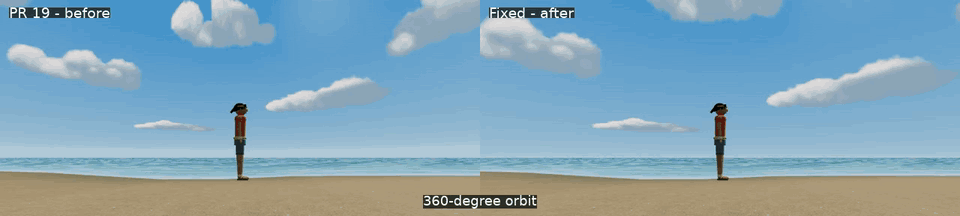

# Stable world sky — PR #20

Base: merged PR #19, main `ffc142eaf12354204eaf91a447b7ae616b98f86b`.

## Root cause

The sky was a **radius-one sphere** rendered with `modelViewMatrix`. Its ordinary-priority `useFrame` callback copied `camera.position`, but `Scene.tsx` mounts the sky before `Player`. The later player callback then translates the camera for walking, the orbit boom, pitch, easing and collision. Rendering therefore viewed a sphere centered on the previous camera position. The texture and sun were attached to that tiny, incorrectly centered sphere, producing strong apparent parallax and warping.

The actual baseline reproduces the defect on both quality settings. The largest sampled center mismatch is **0.676 world units**, over two thirds of the sphere radius. Normal 360-degree orbit samples reach 0.310 units. This is a transform/frame-order defect; cloud animation was already time-based and the dome never copied the camera quaternion.

PR #19's gallery manually established camera positions before rendering, eliminating this mismatch during static captures. A static return-pose test also passes the broken version. Those checks alone cannot detect this bug.

## Fix and rendering audit

`TropicalSky.tsx` now projects `mat3(viewMatrix) * position`: camera rotation converts fixed world directions into the view; camera and object translation never enter the projection. The CPU camera-following copy and mesh ref are removed. There is no dependence on controller callback order and no need to enlarge the sphere.

| Investigation | Finding / resulting behavior |
| --- | --- |
| Dome position and orientation | Local sphere axes explicitly represent world axes. No following transform and no copied camera rotation. |
| World versus view coordinates | Color, clouds and sun use the fixed world-direction varying. Only projection uses view rotation. |
| Yaw, pitch and movement | Rotating reveals new directions; moving the camera cannot change the pattern at a given world direction. |
| UV generation | Original duplicated sphere UVs and atlas retained. Perspective interpolation on the fixed directional sphere remains stable. No per-fragment atan/asin discontinuity or new mip seam. |
| Seam and poles | Tested across the mesh seam at -X and atlas wrap at -Z. U repeats; V clamps. The original atlas's top 176 rows have zero alpha, leaving the polar cap free of pinched clouds. |
| Animation | Original `clock.elapsedTime * .00018` horizontal drift retained. Every motion sample records identical simulation and cloud elapsed times. |
| Sun and horizon | Normalized preset sun and gradient altitude stay in world directions. Camera translation cannot shift the horizon or sun. |
| Depth and order | Opaque pass, `renderOrder=-1000`, `depthWrite=false`, existing depth test and `clip.xyww` far depth retained. World geometry and transparency render in front. |
| Color and resources | Blue gradient, original shaded cumulus atlas, exposure, haze and shared ocean reflection inputs retained. Preset, fallback and disposal assertions pass. |
| Mobile cost | Still one sky draw, the same geometry/atlas, one filtered cloud lookup, and no extra pass or allocation per frame. A low-quality scene sample remains 237 draw calls; this is not a phone FPS measurement. |

## Actual rendered motion evidence

**[Low graphics comparison](evidence/low-comparison.mp4)** · **[High graphics comparison](evidence/high-comparison.mp4)**



These clips contain actual minified-app WebGL frames. All 196 native camera positions, camera quaternions and cloud times match across before/after. Frames are sampled at 10 Hz while the real Player/controller advances at fixed 60 Hz. Playback represents simulation time, not host or iPhone rendering performance. Captures show the canvas; trusted mobile HUD interaction is checked separately.

Each quality/phase includes 98 rendered motion samples: a full 360-degree orbit, 90 degrees out/back, pitch extremes, forward/backward walking, and sprinting while rotating. All 196 fixed native motion samples match the correctly centered reference **exactly**, including max RGB error zero. The reference recenters a duplicate of the same sky after the real Player update; only the diagnostic render is recentered, never the actual scene or controller.

RGB byte mean absolute error against that reference, worst sample per sequence (0–255; low and high give identical sky-only results):

| Native sequence | PR #19 | Fixed |
| --- | ---: | ---: |
| 360-degree orbit | 13.003 | 0 |
| 90 degrees out | 11.027 | 0 |
| 90 degrees back | 11.155 | 0 |
| Pitch changes | 13.911 | 0 |
| Walk forward | 14.235 | 0 |
| Walk backward | 6.212 | 0 |
| Run while rotating | 12.559 | 0 |

Additional deterministic WebGL readbacks freeze cloud time, rotate away and return to an identical camera pose. They compare sky pixels rather than HUD, moving foliage, ocean waves or NPCs:

| Assertion | Low | High |
| --- | ---: | ---: |
| Return after 90 degrees: RGB error | 0 | 0 |
| Return after 360 degrees: RGB error | 0 | 0 |
| Return after looking up/down: RGB error | 0 | 0 |
| Translate camera (10, 3, -8), same orientation: RGB error | 0 | 0 |
| Mesh seam, ±0.00001 rad: mean RGB difference | 0.0051 | 0.0051 |
| Atlas wrap, ±0.00001 rad: mean RGB difference | 0.0034 | 0.0034 |
| Return around zenith: RGB error | 0 | 0 |
| Advance only cloud time by 60 seconds: mean RGB change | 5.275 | 5.275 |

Adjacent-angle seam differences have max error 2 bytes, consistent with the tiny view change and filtering; there is no seam jump. Looking 90 degrees away changes the image substantially (mean RGB difference 15.151), so the sky is not stuck to the screen. Sun direction remains identical throughout.

Raw results: [baseline](evidence/before/report.json), [fixed](evidence/after/report.json), [presets/resources](evidence/integration/report.json), [mobile controls](evidence/controls/report.json), [low scene sample](evidence/profile-low.json). Full sampled JPEG frames are generated into ignored `*-frames` directories and retained by CI's artifact upload.

## Validation

- 106 unit tests pass; TypeScript and the ordinary production build pass.
- Both low/high motion suites pass, after reproducing the baseline defect in both.
- Seven existing atmosphere integration groups pass: midday/afternoon/golden sun, sky and ocean agreement; owned-resource disposal and exposure restoration; missing-atlas blue-sky fallback with real player movement.
- All 16 trusted mobile-control groups pass, including multitouch sprint/look, release, cancel, focus loss, reset, camp/tribal movement and Railay return.
- `git diff --check` passes. Existing chunk-size and mixed static/dynamic import build warnings remain.

The integration test initially failed its animation assertion because `setFrameloop("never")` resets R3F's elapsed clock to zero while the shader still holds its last live time. Advancing to timestamp 1 could take time backwards. The test now advances beyond both values. The [original fixture failure](evidence/integration/initial-fixture-failure.json) is retained; no shipping animation logic changed for that failure. The first motion-route fixture also faced the ocean and could not walk far enough; the corrected test walks along the traversable beach and asserts actual displacement.

## Reproduction

From `artifacts/survivor-camp-prototype`, after installing workspace dependencies and Chromium:

```sh
pnpm qa:sky-motion
ART_QUALITY=low ART_PROFILE_ONLY=1 pnpm qa:atmosphere
ATMOSPHERE_EVIDENCE=../../docs/sky-motion/evidence/integration pnpm qa:atmosphere-integration
SPRINT_EVIDENCE=../../docs/sky-motion/evidence/controls pnpm qa:mobile-sprint
```

`CAMP_CHROMIUM` may select an installed executable. This run used Chromium 153.0.8010.0 via ANGLE SwiftShader. For a baseline capture, run `SKY_PHASE=before node scripts/sky-motion-qa.mjs` with the original PR #19 sky source; this asserts reproduction rather than accepting the defect as a pass. `SKY_SKIP_BUILD=1` reuses an already built phase. QA bridges are injected only into the test build and are absent from the ordinary production build. CI now includes the motion suite.

## Limits and scope

Physical iPhone 17 Pro Max Safari, native GPU behavior, thermal performance and sustained device FPS remain unverified. These are deterministic browser-rendering and input regressions, not device certification. Cloud formations remain the original inexpensive 2D atlas rather than a new volumetric simulation. No jungle, shelter, limestone, geography, gameplay, mobile controls or original SurvivorIsland2025 files were changed.

Draft review only. No merge, deployment or publication.
