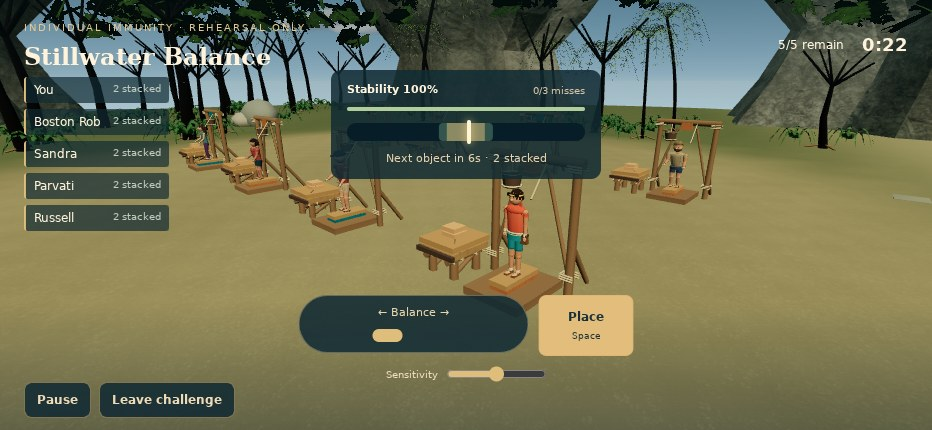
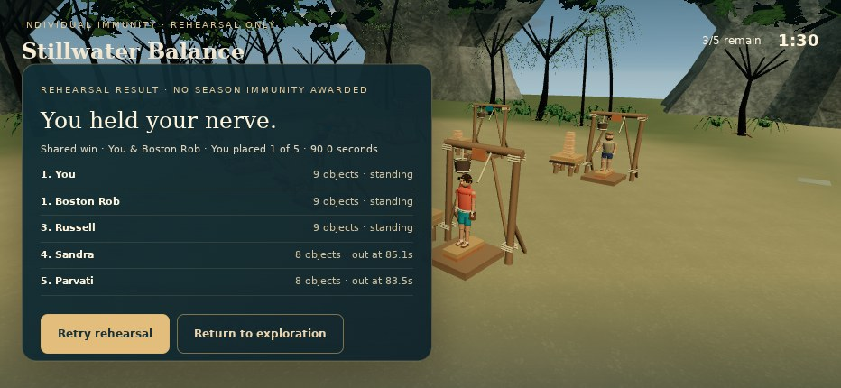
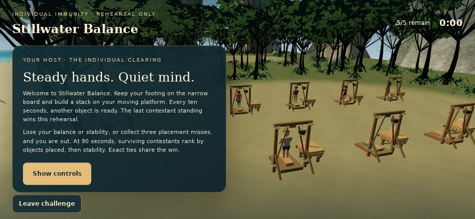

# Actual Stillwater Balance WebGL gallery

All ten images below are direct Chromium SwiftShader WebGL browser captures of the implemented game at runtime `35b89747b825a4c9eab9b330a89648cbe47804b0`, including the real DOM controls. They are not generated concept images. Emulated landscape 932×430 DPR1; no physical iPhone claim. The intro, active play, elimination, results and both quality levels were visually inspected.

| View | Actual capture |
| --- | --- |
| Host introduction · Low | [01-introduction-low.jpg](evidence/01-introduction-low.jpg) |
| Control tutorial · Low | [02-tutorial-low.jpg](evidence/02-tutorial-low.jpg) |
| Active competition · Low | [03-active-low.jpg](evidence/03-active-low.jpg) |
| Keyboard balance struggle · Low | [04-struggle-low.jpg](evidence/04-struggle-low.jpg) |
| Player eliminated / remaining contestants · Low | [05-player-eliminated-low.jpg](evidence/05-player-eliminated-low.jpg) |
| NPC winner and player loss result · Low | [06-results-loss-low.jpg](evidence/06-results-loss-low.jpg) |
| Two successful stack placements · Low | [07-active-stack-low.jpg](evidence/07-active-stack-low.jpg) |
| Nine placements / player shared win · Low | [08-results-win-low.jpg](evidence/08-results-win-low.jpg) |
| Establishing introduction · High | [09-introduction-high.jpg](evidence/09-introduction-high.jpg) |
| Active competition · High | [10-active-high.jpg](evidence/10-active-high.jpg) |

Capture provenance and SHA256 hashes: [evidence/provenance.json](evidence/provenance.json). Full browser checks: [evidence/browser-report.json](evidence/browser-report.json).
