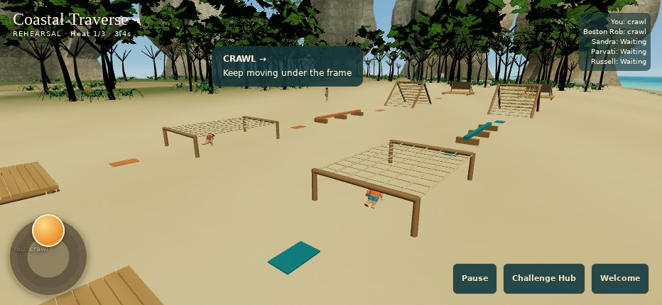
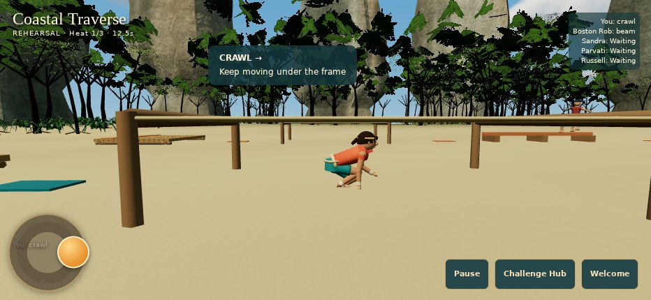
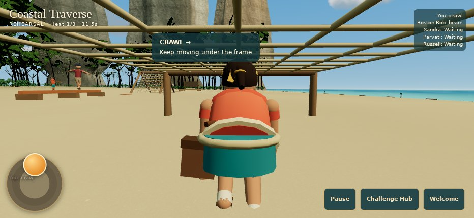
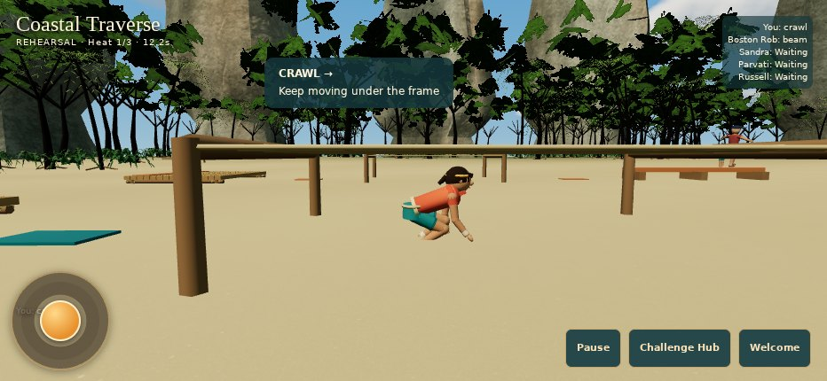
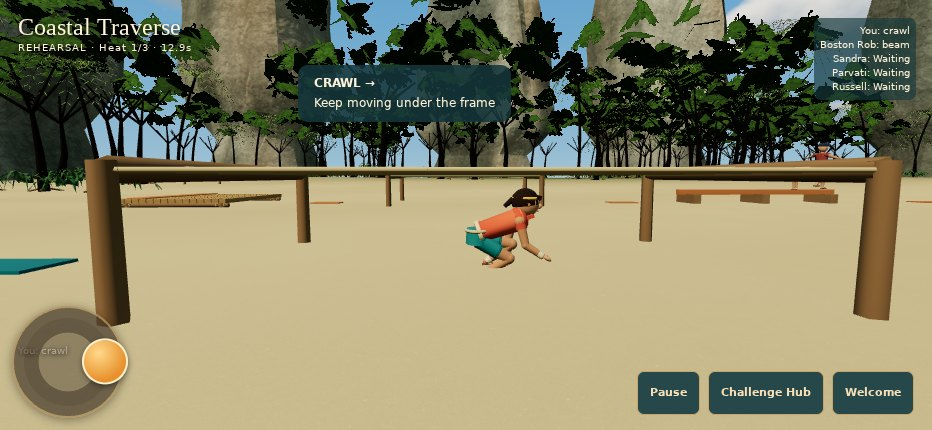
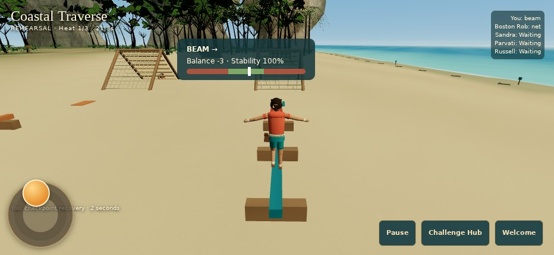
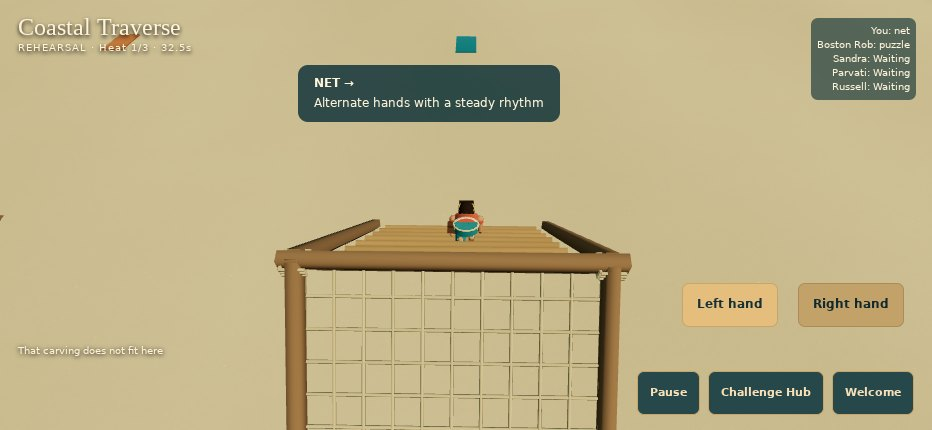

# Third-person foundation — PR #27

The existing prototype now shares analog locomotion, camera-basis handling, behind-player follow/free-look and articulated traversal across exploration and Coastal Traverse. Open challenge sections automatically run; crawl, beam and net select their own gait. Camp retains its optional Run toggle.

## Implemented behavior

- Continuous radial deadzone, bounded diagonal input, acceleration/deceleration, shortest-arc turning and explicit gesture epochs. Held movement does not change direction when inspecting with the other thumb; a new gesture uses the new view.
- Behind-player camera with right-thumb orbit, bounded pitch, 1.6-second look grace, smooth return, cached solid/terrain collision and explicit follow/obstacle/puzzle/introduction/results modes. Staged Stillwater, dialogue and Tribal ownership is preserved.
- Existing player and contestant rigs share a typed locomotion/pose contract. Crawl lowers hips, rotates the torso/head and bends alternating limbs without changing model proportions. A .25-second entry lowering interval precedes forward motion under the roof.
- Beam poses keep feet near the beam, extend arms and communicate instability through the body. The original two-second penalty now has a visible drop/return/recovery presentation.
- Net poses use the actual A-frame support profile for hand/foot targets, continuous crest orientation and slope-aligned feet. Alternating-hand gameplay and deterministic competition remain intact.
- Camp terrain contact benefits from displacement-based planted-foot motion and slope samples. Pause, focus loss, retry, puzzle completion, scene disposal and camp/season preservation remain part of the regression suite.

## Verification

Local foundation and regression tests, TypeScript, production build and 294 collision/six world checks pass. The dedicated browser suite passed on source `bfb1416c8b8d2bb3db9c62efff698777c1c67861` in GitHub run `42419275087`. It drove three complete races through trusted touch input, checked a beam fall/recovery, net hand contact, real mosaic wrong/cancel/multitouch/reset, a comeback win and slower losses, retry, pause/focus release, both graphic modes and exact original camp restoration. There were no uncaught or shader/WebGL errors. The existing mobile suite also passed in Chromium and WebKit. The extended flagship camp sweep passed on `db026b35` in run `42420790839`, including physical route/hiding-site approaches and following a moving water-chore contestant. The strict Challenge Beach GPU residency comparison passed on `86a9d053` in run `42491846301` after warming every owned scene geometry before comparing repeats; no equality assertions were relaxed. Runtime and asset tree fingerprints are identical across all three tested revisions. A later repeated sweep exposed a fixture timing race after the water chore expired while the player approached. The final fixture verifies physical arrival at the spring, keeps the requested work active during observation, and explicitly starts the return leg; no actor positions/routes are assigned and distance/expanded-territory assertions remain. PR #27 records final-head CI status.

Four consecutive crawl frames measure full-proportion rendered heights of 1.016, 0.998, 0.997 and 1.019m under the 1.05m opening. Joint/body scales remain authored; the fresh-main before capture records the removed body scale `[1,.43,1]`. Actual net-hand contact error is 0.043m at the crest and 0.052m on descent. Reviewed captures show full character framing under the crawl roof and above the net crest, plus a directly-behind beam view.

## Evidence

All images are actual WebGL captures. The image paths below are relative to `evidence/`. `evidence/source-manifest.json` records exact implementation hashes, tested SHA, run, artifact and SHA-256. `evidence/browser-report.json` contains raw timing, contact, resource and preservation assertions. `evidence/before/` was freshly captured from main `af9c61c` in the same CI run.

| Requested view | Capture |
| --- | --- |
| Camp walk / run | `camp-walk.jpg`, `camp-run.jpg` |
| Behind follow / free-look | `behind-follow.jpg`, `free-look-camp.jpg`, `free-look-race.jpg` |
| Crawl entry / active sequence / exit | `02-crawl.jpg`, `crawl-0.jpg` through `crawl-3.jpg`, `crawl-exit.jpg` |
| Beam / cargo net | `beam-supported.jpg`, `net-0.jpg`, `net-1.jpg` |
| Puzzle / restored follow / results | `03-karst-mosaic.jpg`, `puzzle-to-follow.jpg`, `04-real-results.jpg` |
| High mode | `05-high-course.jpg` |

### Before and after

| Original main crawl | Articulated crawl beneath the roof |
| --- | --- |
|  |  |

| Crawl frame 1 | Crawl frame 2 | Crawl frame 3 | Crawl frame 4 |
| --- | --- | --- | --- |
|  |  |  |  |

| Behind beam follow | Net traversal |
| --- | --- |
|  |  |

Camera CPU mean is 0.057ms Low / 0.029ms High, P95 0.1ms in both; these are runner measurements, not phone FPS. Repeated scenes preserve exactly 89 scene geometries, 127 owned resources and 38 listeners, with no GPU residency growth and complete owned-world teardown. Details and measurement limits are in PERFORMANCE.md. No physical iPhone testing is claimed.

See ROOT_CAUSES.md, ANIMATION_STATES.md, CAMERA_BEHAVIOR.md, PERFORMANCE.md, KNOWN_LIMITATIONS.md and the short IPHONE_TEST_GUIDE.md. Keep the pull request DRAFT and unmerged. No deployment, publishing, Replit or reference-repository modifications.
