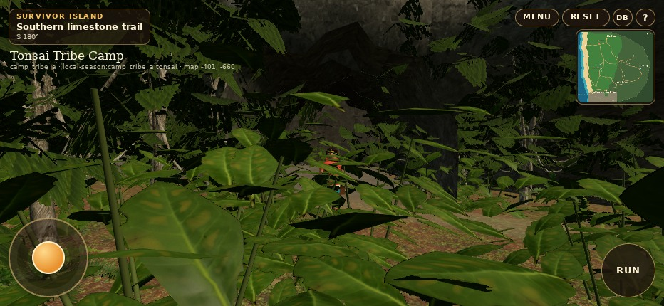
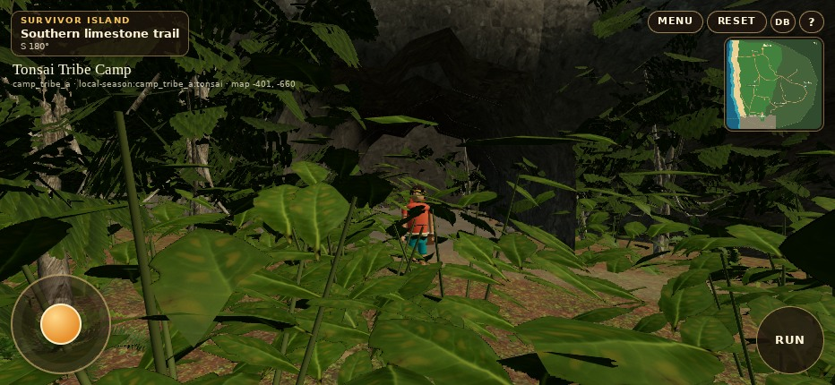
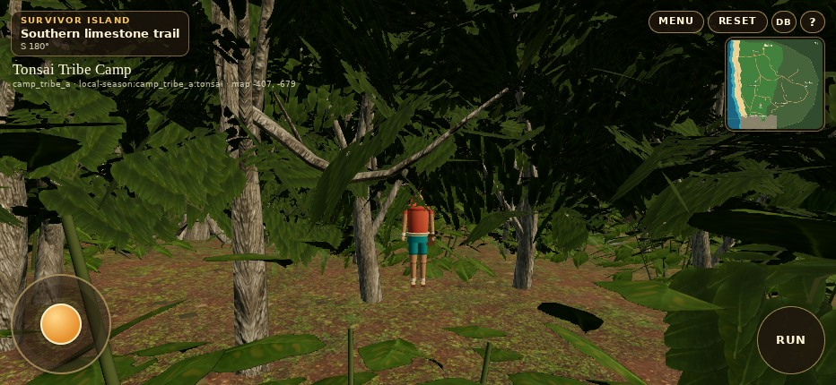
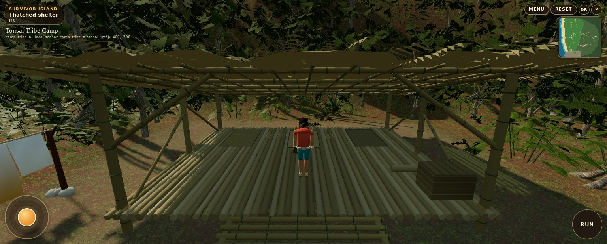

# Tonsai completion: actual WebGL review

These are production WebGL captures with the normal third-person Player camera. No generated imagery or screenshot retouching. Art images: Chromium 156 / ANGLE SwiftShader, 932×430 DPR1, `19c7385`, run [41937391598](https://github.com/sunsetseast/SurvivorIsland3Dprototype/actions/runs/41937391598). Shelter images: native Player camera, 1536×620 DPR1, `b82fc2a`, run [41938146416](https://github.com/sunsetseast/SurvivorIsland3Dprototype/actions/runs/41938146416). Host rendering is not physical iPhone certification.

## Cave and southern trail

The original PR #22 capture before this completion pass shows the foreground obstruction. The completion retains dense surrounding plants while clearing the character's immediate sightline.

| Previous PR #22 | Completion |
| --- | --- |
|  |  |

Low-mode counterparts: [cave](evidence/completion/low-cave-entrance.jpg), [inland trail](evidence/completion/low-inland-limestone.jpg). All cave body/edge/entry/exit checks are covered by unit tests and the browser routes; an image alone does not certify collision.

## Shelter sleeping area

Added inspection from the actual gameplay camera, facing into the shelter. Woven sleeping mats, rolled spare, original deck/ramp, bamboo support structure and the refined palm roof remain visible. This view was added to review the new details; it is not a matched before/after pair.

[Paired resource/camera comparison](evidence/completion/comparison.json) · [Before report](evidence/completion/before/report.json) · [After report](evidence/completion/after/report.json) · [Travel report](evidence/completion/travel-report.json) · [Exact provenance](evidence/completion/provenance.json)
