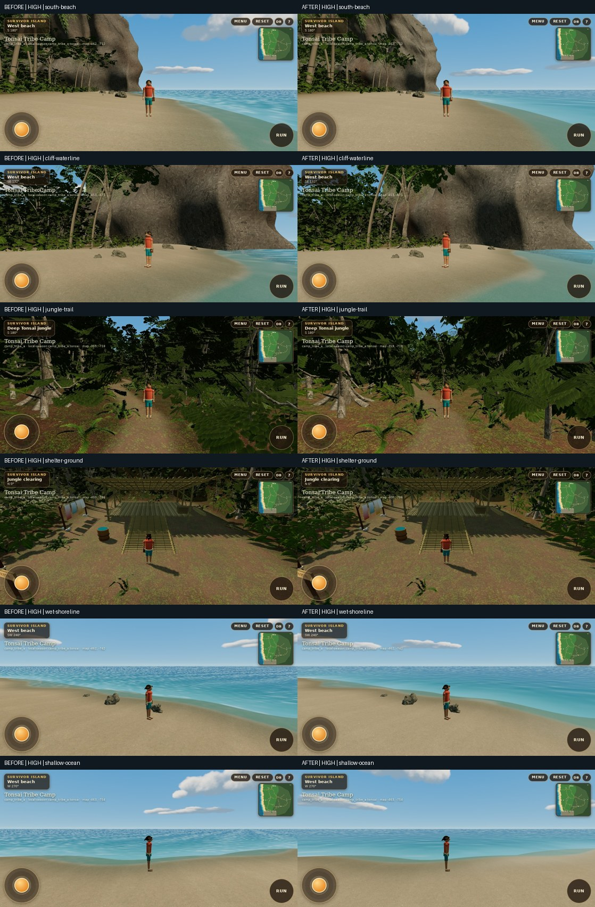

# Tonsai environment art — PR22

Based on merged PR21/main `7b93d5444946217a6c5a59acb93ada563e6c1288`. Draft review only; no merge, deployment or publishing.

Tonsai's southern wall was technically repaired in PR21, but its rounded lobes still looked procedural. Repeated ground detail, noisy water and broad leaf cards weakened the normal third-person view. This pass refines those four areas without changing the map or adding resident geometry or textures.

[Initial visual audit](AUDIT.md) · [56 before/after WebGL captures](GALLERY.md) · [Performance measurements](PERFORMANCE.md) · [Validation and recovery](VALIDATION.md)

## Implemented

- **Limestone:** unequal fracture sections and a broken upper ridge replace rounded upper lobes. An offline height field transferred from the existing CC0 scanned boulder adds bounded relief to the shipped southern meshes. Displacement fades out below 11–20 m and avoids horizontal surfaces. Pale limestone, localized oxide staining and finer rotated mineral detail improve scale. Both detail exports retain the previous triangle budgets; northern/offshore scan silhouettes and unrelated landmark geometry remain unchanged.
- **Ground:** rotated detail at multiple scales breaks up sand and leaf-litter repetition. Albedo variation softens trail/clearing transitions, and the existing shoreline mask controls damp-sand roughness. Terrain heights, shoreline coordinates and walkability are unchanged.
- **Water:** rotated, advected wave slopes with a smooth analytical noise derivative replace the square-looking normal field. Broken, restrained swash replaces regular foam bands. The existing shoreline field, sky colors and atmosphere uniforms remain connected.
- **Foliage:** existing textured sprays become narrower, cupped, twisted and variably mirrored, with restrained leaf fill. No plants, texture images or mesh triangles were added. Changed bounds slightly affect which instances are submitted at particular camera poses.
- **Regression coverage:** actual exported-mesh relief, near/far correspondence, a 2,311-point body-clearance comparison against PR21, matched-camera/resource comparison, and a dedicated WebGL CI workflow.

The geometry is authored by reproducible offline scripts; this is not a claim of hand-sculpted Blender production. The relief reuses an existing licensed source. No new third-party asset or rendering dependency was introduced.

## Visual assessment

The most visible improvement is quieter water from beach gameplay views. The cliff has a less rounded upper profile and more surface variation; sand/litter transitions and leaf sprays are less uniform. The shelter view shows a smaller change because its geometry was intentionally preserved. Existing caves, lower cliff feet and planted contact points retain their layout.

The result remains stylized. Some broad cliff surfaces and dark/repeated canopy forms are still visible, and the simplified player character is unchanged. The inspection images make the ridge easier to assess but are explicitly separated from native Player-camera evidence.

## Scope preserved

Camp geography, southern boundary, 12 trails, all 39 hiding candidates, cave and spring access, shelter geometry, NPC routes, touch controls, camp/social/save contracts, connected travel, Tribal Council, atmosphere presets and PR20's world-stable sky behavior are retained. The reference repository `SurvivorIsland2025` was not modified.

## Verification outcome

112 unit tests and TypeScript pass. All four rebuilt GLBs reproduce byte for byte; geometry outside the intended cliff/leaf meshes is unchanged. Saved production WebGL comparisons contain 24 native-camera pairs plus four inspection pairs, with zero measured native camera-coordinate error. Gameplay, touch-control, connected-world and atmosphere suites pass. See the linked raw reports and validation notes for their limits.

Spawn draw calls, resident geometry arrays and estimated texture storage are unchanged. Submitted triangles rise by **0.43% low / 0.41% high**. Host software-render timing samples vary and do not establish iPhone performance. Physical iPhone Safari, sustained frame rate, thermals and battery behavior remain unverified.
