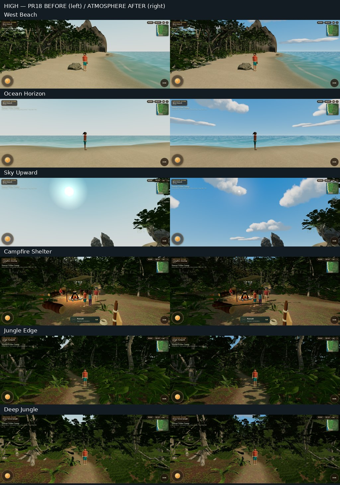
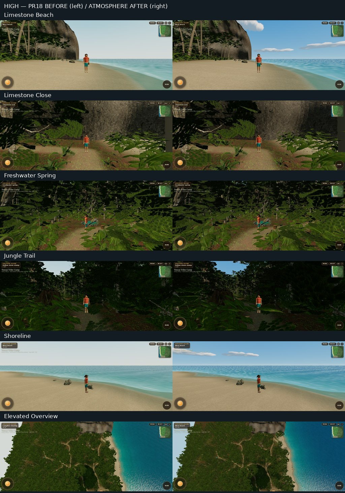
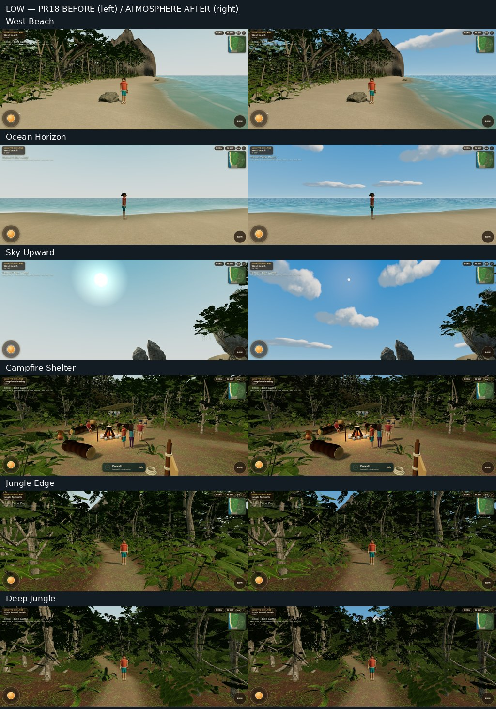
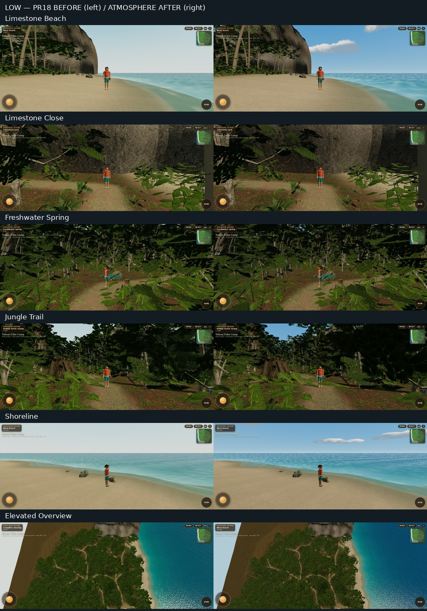

# Matched WebGL gallery

48 genuine screenshots: twelve viewpoints × low/high × PR18/after. Both builds use Chrome headless shell 156.0.8078.79, ANGLE SwiftShader, a 1536 × 620 touch viewport and DPR1. The baseline is merged main `76b84bc`. The production bundles are minified; the Vite plugin in `atmosphere-qa.mjs` adds only QA access to existing world/input objects. No debug bridge is shipped in the normal production build.

Ten views per profile use the actual Player follow camera and identical teleport/yaw/pitch fixtures. The recorded native-camera X/Y/Z displacement between before and after is **0 m**. The upward camera and elevated overview are explicitly controlled inspection cameras, applied before every subscriber so vegetation culling sees the same camera used for rendering. The overview uses camera `[20,145,0]` looking at `[20,4,40]`; this avoids placing the camera beyond the habitat's normal horizontal visibility radius. It remains a diagnostic view, not an expanded playable camera/world.

Originals and camera records: [before](evidence/before/report.json), [after](evidence/after/report.json). All contact sheets retain the originals; they only resize and label them. NPC activity/faces may differ slightly with startup timing. No AI mockup is used as implementation evidence.

| View                        | Low before                                        | Low after                                        | High before                                        | High after                                        |
| --------------------------- | ------------------------------------------------- | ------------------------------------------------ | -------------------------------------------------- | ------------------------------------------------- |
| West beach toward limestone | [Open](evidence/before/low-west-beach.jpg)        | [Open](evidence/after/low-west-beach.jpg)        | [Open](evidence/before/high-west-beach.jpg)        | [Open](evidence/after/high-west-beach.jpg)        |
| Ocean horizon               | [Open](evidence/before/low-ocean-horizon.jpg)     | [Open](evidence/after/low-ocean-horizon.jpg)     | [Open](evidence/before/high-ocean-horizon.jpg)     | [Open](evidence/after/high-ocean-horizon.jpg)     |
| Beach looking upward        | [Open](evidence/before/low-sky-upward.jpg)        | [Open](evidence/after/low-sky-upward.jpg)        | [Open](evidence/before/high-sky-upward.jpg)        | [Open](evidence/after/high-sky-upward.jpg)        |
| Campfire and shelter        | [Open](evidence/before/low-campfire-shelter.jpg)  | [Open](evidence/after/low-campfire-shelter.jpg)  | [Open](evidence/before/high-campfire-shelter.jpg)  | [Open](evidence/after/high-campfire-shelter.jpg)  |
| Jungle edge                 | [Open](evidence/before/low-jungle-edge.jpg)       | [Open](evidence/after/low-jungle-edge.jpg)       | [Open](evidence/before/high-jungle-edge.jpg)       | [Open](evidence/after/high-jungle-edge.jpg)       |
| Deep jungle                 | [Open](evidence/before/low-deep-jungle.jpg)       | [Open](evidence/after/low-deep-jungle.jpg)       | [Open](evidence/before/high-deep-jungle.jpg)       | [Open](evidence/after/high-deep-jungle.jpg)       |
| Limestone from beach        | [Open](evidence/before/low-limestone-beach.jpg)   | [Open](evidence/after/low-limestone-beach.jpg)   | [Open](evidence/before/high-limestone-beach.jpg)   | [Open](evidence/after/high-limestone-beach.jpg)   |
| Limestone close-up          | [Open](evidence/before/low-limestone-close.jpg)   | [Open](evidence/after/low-limestone-close.jpg)   | [Open](evidence/before/high-limestone-close.jpg)   | [Open](evidence/after/high-limestone-close.jpg)   |
| Freshwater spring           | [Open](evidence/before/low-freshwater-spring.jpg) | [Open](evidence/after/low-freshwater-spring.jpg) | [Open](evidence/before/high-freshwater-spring.jpg) | [Open](evidence/after/high-freshwater-spring.jpg) |
| Jungle trail                | [Open](evidence/before/low-jungle-trail.jpg)      | [Open](evidence/after/low-jungle-trail.jpg)      | [Open](evidence/before/high-jungle-trail.jpg)      | [Open](evidence/after/high-jungle-trail.jpg)      |
| Shoreline                   | [Open](evidence/before/low-shoreline.jpg)         | [Open](evidence/after/low-shoreline.jpg)         | [Open](evidence/before/high-shoreline.jpg)         | [Open](evidence/after/high-shoreline.jpg)         |
| Elevated landscape overview | [Open](evidence/before/low-elevated-overview.jpg) | [Open](evidence/after/low-elevated-overview.jpg) | [Open](evidence/before/high-elevated-overview.jpg) | [Open](evidence/after/high-elevated-overview.jpg) |









## Reproduce comparisons

Preserve the same `atmosphere-qa.mjs` harness in separate PR18 and current checkouts. With dependencies installed, run from each app directory:

```bash
ART_PHASE=before ART_RENDER_TIMING=1 node scripts/atmosphere-qa.mjs
ART_PHASE=after ART_RENDER_TIMING=1 node scripts/atmosphere-qa.mjs
```

`ART_SKIP_BUILD=1` reuses a preserved test build; it must match the labeled source. `ART_POSES` selects native views; the two inspection views are always captured unless `ART_PROFILE_ONLY=1`. `ART_QUALITY=low` or `high` selects one profile. `ART_EVIDENCE` selects an output directory, and `CAMP_CHROMIUM` selects an installed WebGL-capable Chromium. Production evidence is not physical-device certification.
