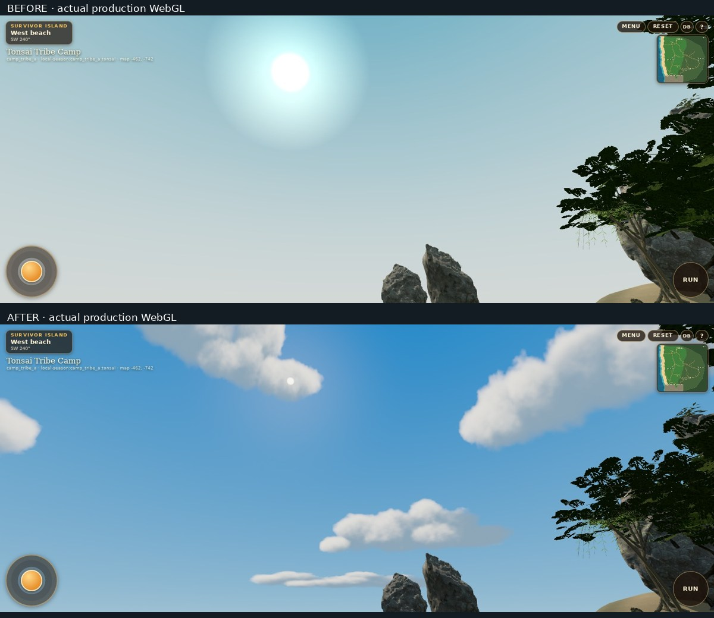

# Tonsai tropical atmosphere

The camp now has a blue Andaman daytime sky, shaded drifting cumulus, a controlled solar disc, matching sunlight and a sky-colored sea. The baseline is merged PR18/main **76b84bc8b61fb4a1ecdd8bc0c28848492a1878f9**. The implementation stays inside the existing independently loaded camp location.

[48 matched production WebGL captures](GALLERY.md) · [Performance](PERFORMANCE.md) · [Regression evidence](GAMEPLAY.md) · [Asset and shader provenance](ASSETS.md)

## Rendering audit and choice

The camp did **not** use the separate Railay `CoastalSky` component. `Terrain.Sky` painted a 120 m vertex-color sphere from pale gray-green `#d6e2db` through cyan to `#4d9dbd`. Most gameplay looks toward its pale low-altitude region. An additive 60 m sun plane at 110 m subtended roughly 30 degrees, adding a broad washed-out glow. There were no camp clouds. Background and fog were similarly pale; the ocean reflected a different hardcoded gray-green sky.

The actual renderer was already ACES Filmic (4), exposure 1, sRGB output and 4-sample antialiasing on this host. There was no duplicate output conversion to fix. The dominant cause was the authored sky palette/gradient and broad glow, with pale fog reinforcing it. The change keeps ACES and sRGB, uses modest exposure 0.96 only while Camp is mounted, and restores the previous renderer settings on departure.

Three.js Sky/Preetham scattering, the existing Railay noise shader, a hand-controlled gradient, and sky/HDR textures were evaluated. Sky supports analytic daylight scattering, but would still need separate clouds and calibration. An HDR environment/cube chain adds downloads, texture memory and source-sun alignment work. The selected approach is one background shader, a seamless directional gradient and an original 1024 × 512 cloud atlas. The cloud volumes and light extinction are computed offline; runtime does one filtered cloud lookup, with no raymarch, PMREM, extra offscreen target or weather simulation. The atlas moves slowly in azimuth. The dome's duplicated seam UVs provide locally continuous mip derivatives and avoid per-pixel trigonometric projection. The solar disc and all lighting use the same normalized direction.

## Implemented environmental polish

- `atmosphere.ts` holds the shared linear-light sky, sun, ambient, haze, water and cloud colors. Bright midday is the default. `?devTravel=1&atmosphere=afternoon` and `golden` are inspection presets; they do not alter gameplay time, save state or progression.
- Cool sky illumination, warm direct sunlight and a restrained 105–290 m haze range retain readable shaded trails and beach/forest contrast. The sky is drawn at the far depth plane, independent of the camp's finite far clip.
- Ocean Fresnel reflection uses the same directional sky gradient and sun. Shallow/offshore colors, softened glints and foam stay in the existing shoreline-driven surface. Its low/high grids fall from 100² to 48²/72² cells; shoreline masking still samples the same continuous coastline field.
- Near foliage changes from noisy alpha hashing to MSAA alpha-to-coverage, with a shorter close-camera fade. Photographic crown cutouts are filtered too. Slight per-instance crown stretch and tint vary existing silhouettes; wood/camera blockers keep their original transforms. All plant placements and habitat density remain.
- Far cupped leaves retain **56 leaves per plant**, with two longitudinal sections instead of three. Near meshes are retained. This removes distant geometry rather than plants. Both low/high kits and source-hash manifests are regenerated.
- Limestone retains its geography and cave geometry. A second rotated material scale and uneven mineral strata/runnels break the large scan repeat; normal strength is reduced. Existing surface-fitted cliff vegetation remains. Shelter thatch fill is less emissive; the open lashed Survivor shelter is retained.
- Sky geometry, material, cloud map, fallback texture and late asynchronous loads have explicit location ownership and cleanup. A missing cloud atlas leaves the gradient and sun usable.

## Visual review

The normal-size comparison is visibly strongest at the ocean, shoreline and upward views: the pale empty sky becomes blue with separated cloud formations, a smaller sun and a coherent blue/turquoise sea. The final cloud atlas has organic eroded edges and internal light/shadow variation. There are no sphere-cloud props, skybox edges or visible longitude lines in the inspected captures. Sand and rock retain surface detail. Jungle trails, the spring, campfire and shelter remain readable and enclosed.

The foliage improvement is incremental: edge noise is reduced, especially near the camera, but some leaf cards and repeated branch structures remain apparent. Dense upper canopy can still read dark against the sky. Rock close-ups are still procedural and below a hand-sculpted environment-art target; this pass improves shading and material variation, not the underlying geography or major silhouette. Ground/cliff styling, simple characters and finite ocean/world bounds remain visible in diagnostic views. This is a self-reviewed stylized environment improvement, not independent AAA certification.

## Limits

Physical iPhone Safari, sustained device GPU frame times, thermals and battery use remain unverified. Software-renderer timing is reported separately from geometry savings and must not be presented as phone FPS. Cloud lighting is baked for a high western sun; the development presets recolor it and move the sun, rather than relighting a volume at runtime. A future full day/night/weather system needs additional cloud-lighting authoring. No gameplay/save schema, reference-repository content, map geography or journey authorization is changed. Nothing is merged, deployed or published.
