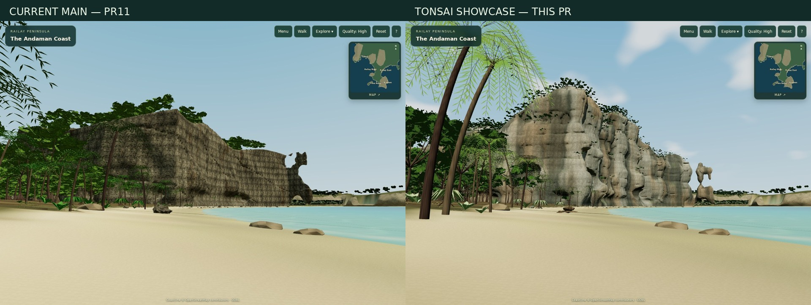
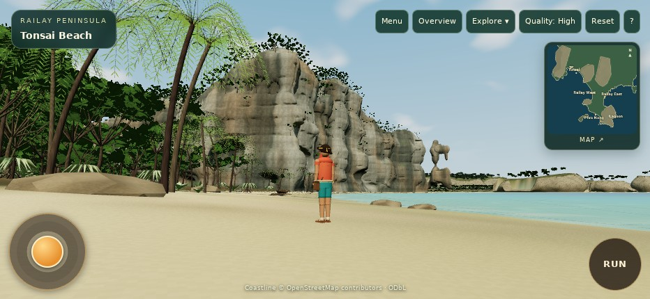
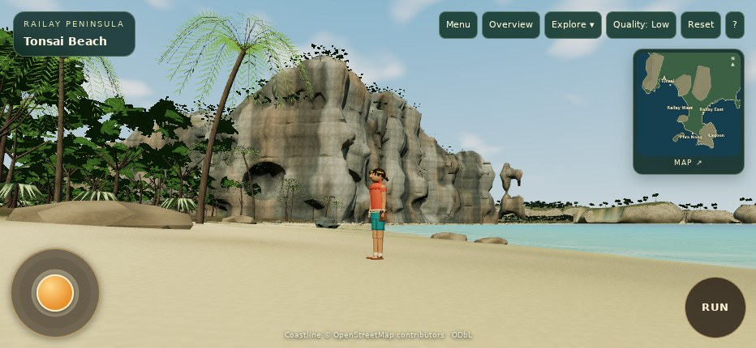

# Real WebGL gallery

These are screenshots of the Three.js application. The comparison only scales and labels the two original captures; it does not retouch either world. Both full originals are linked below.

- [Full main benchmark](evidence/before/19-benchmark.jpg)
- [Full proposed benchmark](evidence/after/19-benchmark.jpg)
- [Low quality, same position](evidence/after/20-benchmark-low.jpg)
- [Ground-level cliff inspection](evidence/after/05-cliff-hero.jpg)
- [Understory inspection](evidence/after/11-understory.jpg)
- [Palm inspection](evidence/after/12-palms.jpg)
- [932×430 landscape composition](evidence/after/16-iphone-landscape.jpg)

[Expanded map](evidence/21-expanded-live-map.jpg) · [Camp regression](evidence/regression-camp.jpg) · [Tribal Council regression](evidence/regression-tribal.jpg)

The fixed benchmark camera is at terrain+1.7m on a walkable beach coordinate. The separate player screenshot uses the real following camera and UI. Phone layout/touch emulation does not establish physical iPhone Safari performance. See [the review](REPORT.md) for remaining visual limitations and [raw counters](evidence/after/webgl-report.json).
