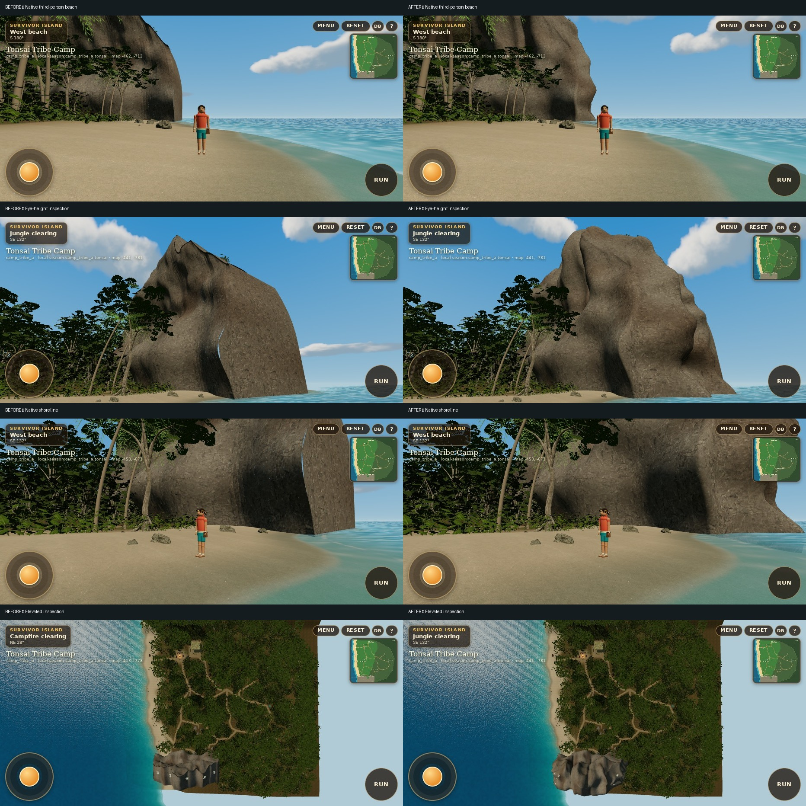

# Tonsai limestone reconstruction

Base: merged PR20 / main `5d54f292`. Draft only; no merge, deployment or game publication.

[Before/after gallery](GALLERY.md) · [Measured comparison](comparison.json) · [Original audit](AUDIT.md) · [Winding probes](winding-audit.json)



## What changed and why

The southern Camp formation used a separate offline procedural mesh from the successful scanned northern/offshore rocks. Its west end was a largely planar cap extending to a fixed rear plane. It also used **inward west-cap and downward crown winding**. The shared front/cap used different vertex-row sampling, leaving a visible blue slit and a severe shading boundary. A UV-projected normal map did not match the triplanar diffuse material. This was geometry/topology first, rather than missing texture resolution.

The original exported GLB probe has west-face normal X **+0.995**, directed into the rock; the new GLB gives **−0.818**. A representative crown normal changes Y **−0.581 → +0.708**. Raw probe positions/normals are retained separately.

- Replaced the end caps with continuous wraparound headland sections: unequal buttresses, recesses, undercuts, uneven crown heights, and a shaped rear enclosure.
- Shared front/end sample heights close the exposed join. Crown triangles face upward. The lower front/cave envelope remains in its established location.
- Extended the western side below sea level and merged four small, partly submerged erosion toes into the existing rock draw. No scatter field or new islands.
- Added sparse ledge/crown shrubs through the existing instance batch. Downward probes reject steep faces; root heights use the lower of both shipped LOD contacts so a detail switch cannot leave plants floating.
- Retained existing multiscale mineral/albedo/roughness maps and vertex staining. Removed the misaligned UV normal map from the triplanar natural-landmark material; geometric normals now provide coherent relief. Scanned offshore materials retain their original normal mapping.
- Rebuilt separate low/high GLBs with unchanged mesh names, existing download ceilings and per-mesh triangle budgets. No new framework, dependency or texture.

This remains original offline procedural section authoring with the existing licensed CC0 boulder derivative for small rocks. It is not a claim of a hand-sculpted Blender asset.

## Formation audit

| Formation | Current construction | Decision |
| --- | --- | --- |
| Southern headland / ocean end | Offline procedural mesh in `landmarks[-low].glb` | Reconstructed caps/crown, winding and sampling; underwater foot and attached toes |
| Southern cave | Actual open vault and back wall in the same mesh | Retained opening/interior and reachable approaches; anchors validated in both LODs |
| Northern beach-facing headlands | Existing CC0 scan with uniform world scales | Retained successful silhouettes and original materials |
| Two offshore formations | Same uniformly scaled scan, separate placements | Retained geometry/placement; matched north-view submissions are identical |
| Inland moss gates, strangler stone, quiet alcove | Offline scan-derived landmark meshes | Retained shapes/collision footprints; share corrected geometric-normal material |
| Spring rim and small beach rocks | Existing instanced scan fragments | Retained; no path obstruction introduced |
| Railay journey karsts | Independent imported GLB pipeline | Retained; Camp reconstruction does not replace journey assets |

No changes to territory, the southern exploration boundary, any of the 12 trail definitions, the baked navigation graph, 39 candidate IDs/anchors, spring, shelter/fire, player/controller, social systems or save schema. PR20’s sky shader is byte-unchanged. The new visible rear surface stays outside the established traversable envelope. A wider clearance sweep caught low eastern ledges intruding into previously walkable ground; the final eastern skirt stays at the original x=42 boundary below standing clearance, retaining only higher overhangs. Both detail levels pass the expanded sweep.

## Visual review

**44 genuine screenshots:** 11 matching views × low/high × before/after. Nine views use the real native Player camera; the eye-height coast inspection and elevated overview are explicitly separate diagnostics. All use 932 × 430 / DPR1; native projection is unchanged. Camera comparison gives **zero coordinate/orientation error**. The wider overview was recaptured on both phases to fit the headland.

The straight west slab, blue join slit and right-angle shoreline end are removed. The clear inspection view shows the asymmetric full profile; the native beach/shoreline views show its gameplay scale. Cave and inland views remain accessible. Camp/approach frames retain the existing foliage occlusion. Clouds advance by normal elapsed time; pixel-identical cloud shapes are not asserted.

The material is intentionally stylized and still has broad relatively calm faces. It is not a detailed photogrammetric replica of Tonsai. Existing dark canopy, foliage cutout shapes, terrain-edge visibility in the diagnostic overview, and inexpensive water are outside this reconstruction. Physical iPhone Safari remains untested.

## Measured cost

Production Chromium 153 / ANGLE SwiftShader. Counts include submitted passes such as shadows. Geometry bytes are CPU arrays; image storage is an RGBA8+mips estimate excluding driver overhead, shadow/render targets and compression behavior.

| Quality | Spawn triangles | Spawn draw calls | Geometry arrays | Estimated images |
| --- | --- | --- | --- | --- |
| low | 680,644 → 680,644 | 234 → 234 | 19.837 → 19.855 MiB | 52.48 → 52.48 MiB |
| high | 980,009 → 980,009 | 251 → 251 | 25.219 → 25.222 MiB | 52.48 → 52.48 MiB |

| Native view | Submitted triangles | Draw calls |
| --- | --- | --- |
| low / south-beach | 289,899 → 291,979 (+0.72%) | 147 → 147 |
| low / north-offshore | 567,180 → 567,180 (+0.00%) | 250 → 250 |
| low / waterline | 417,965 → 420,493 (+0.60%) | 173 → 173 |
| low / cliff-beside | 190,080 → 191,712 (+0.86%) | 130 → 130 |
| low / distant-silhouette | 432,528 → 434,160 (+0.38%) | 160 → 160 |
| high / south-beach | 439,433 → 443,563 (+0.94%) | 166 → 166 |
| high / north-offshore | 1,037,149 → 1,037,149 (+0.00%) | 263 → 263 |
| high / waterline | 803,801 → 807,931 (+0.51%) | 187 → 187 |
| high / cliff-beside | 308,048 → 311,282 (+1.05%) | 143 → 143 |
| high / distant-silhouette | 620,004 → 622,532 (+0.41%) | 174 → 174 |

The low landmark download changes **986,360 → 1,006,012 bytes** (+19,652); high changes **3,838,264 → 3,841,196** (+2,932). Texture storage and texture-image payload are unchanged. High contains both detail levels; low downloads only far meshes. The existing LOD switch/distances and culling remain.

An isolated repeat with no other browser QA running gives spawn frame-finish medians **4.85 → 4.30 ms low**, **4.45 → 4.55 ms high** (12 samples/profile). Isolated menu-to-scene readiness is **3,010 → 3,226 ms low**, **5,287 → 2,974 ms high**. The small high render increase and inconsistent loading directions do not establish a performance gain or meaningful regression.

During the earlier screenshot pass, a co-scheduled high sample was slower (**4.5 → 11.15 ms**, while low was **7.4 → 3.45 ms**). Both original observations and the isolated repeat are retained in the JSON reports. These cache/scheduling-sensitive software-host observations do not establish sustained performance or phone FPS. Initial 1536-pixel captures were slow and interrupted; all final matched evidence was repeated at phone landscape size. No mobile GPU/thermal bottleneck is certified. The existing million-triangle high scene and foliage overdraw remain device-validation concerns.

## Validation

See `VALIDATION.md` for final command results and raw browser reports.

The three new tests reject a planar cap, inward normals, missing submerged surface, large LOD mismatch and new body-height intersections. They scan **2,311 southern and inland-edge walkable grid samples** in both detail levels. The baseline already has seven geometric cave-cheek intersections on that grid; six remain, all at x=7 beside the existing vault. The new scan introduces none. Existing independent cave-centre routes, collision sweeps, navigation and all 39 surface-anchor checks remain authoritative for gameplay access.

## Reproduce

From `artifacts/survivor-camp-prototype`:

```sh
pnpm assets:karst
pnpm typecheck
pnpm test
PORT=5200 BASE_PATH=/ pnpm build
pnpm qa:karst
python3 ../../tools/camp/karst/compare.py
```

Set `CAMP_CHROMIUM` for an installed WebGL-capable Chromium. `ART_PHASE=before` labels an actual baseline build; `ART_SKIP_BUILD=1` reuses a preserved phase build and must only be used when its source identity is known. Optional `ART_QUALITY`, `ART_POSES`, `ART_EVIDENCE`, `ART_PRESET` select focused captures. `ART_INSPECTION_ONLY=1 ART_INSPECTION_NAMES=elevated-overview ART_APPEND=1` refreshes only that diagnostic in an existing report. Test bridges are injected into QA builds only. The ordinary production build contains no new QA bridge.

Visual/geological references: [NASA’s Krabi coast](https://science.nasa.gov/earth/earth-observatory/thailands-krabi-coast/) and [QT Luong’s Railay overhang photograph](https://www.terragalleria.com/asia/thailand/railay/picture.thai48234.html). Used for visual study of vertical massing, undercuts, mineral surfaces and sparse cliff vegetation; neither image is bundled or used as an asset.
