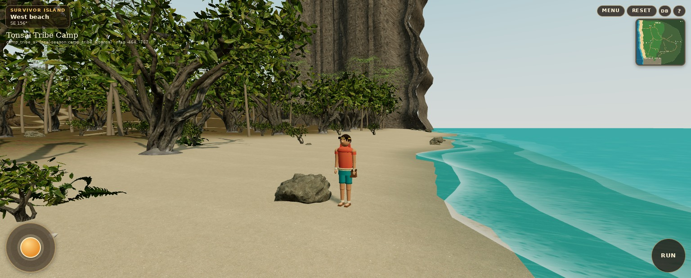
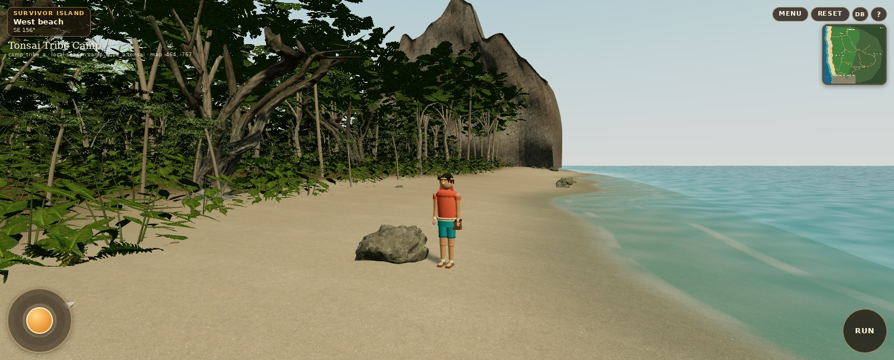
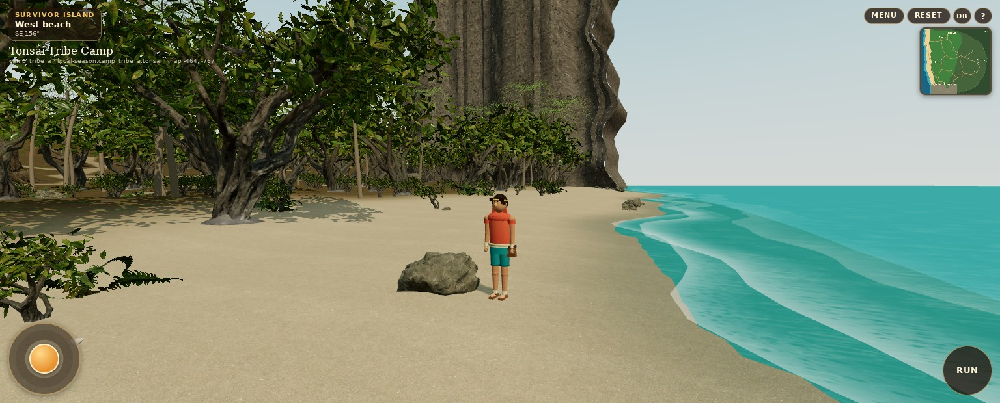
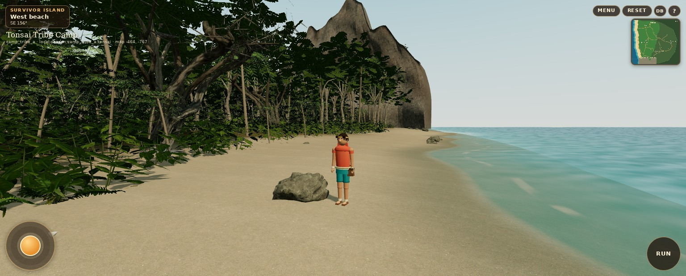

# Genuine WebGL comparison gallery

Baseline: merged PR17, main `5249bf253db78a0808ffe2ffe348155ca7a5188e`. After: this branch. Screenshots are from test-instrumented **minified production builds**, Chromium ANGLE SwiftShader, 1536 × 620, DPR 1, mobile/touch layout. The actual Player controller supplies native camera placement. The capture harness fixes simulation steps, player position, yaw, pitch and quality. Software rendering is not physical iPhone certification.

The primary checkpoint approximates the user's southeast-facing iPhone failure view; its camera data was unavailable. It uses `x=-52, z=-13, yaw=-2.72, pitch=0.10`. Both captures use exactly that checkpoint. The original screenshot's browser chrome is excluded from the game viewport.

## West beach — low

Before:

After:

## West beach — high

Before:

After:

## Every native gameplay checkpoint

| View | Before low | After low | Before high | After high |
| --- | --- | --- | --- | --- |
| west beach | [image](evidence/before/low-west-beach.jpg) | [image](evidence/after/low-west-beach.jpg) | [image](evidence/before/high-west-beach.jpg) | [image](evidence/after/high-west-beach.jpg) |
| shelter | [image](evidence/before/low-shelter.jpg) | [image](evidence/after/low-shelter.jpg) | [image](evidence/before/high-shelter.jpg) | [image](evidence/after/high-shelter.jpg) |
| shelter from fire | [image](evidence/before/low-shelter-from-fire.jpg) | [image](evidence/after/low-shelter-from-fire.jpg) | [image](evidence/before/high-shelter-from-fire.jpg) | [image](evidence/after/high-shelter-from-fire.jpg) |
| shelter interior | [image](evidence/before/low-shelter-interior.jpg) | [image](evidence/after/low-shelter-interior.jpg) | [image](evidence/before/high-shelter-interior.jpg) | [image](evidence/after/high-shelter-interior.jpg) |
| communal camp | [image](evidence/before/low-communal-camp.jpg) | [image](evidence/after/low-communal-camp.jpg) | [image](evidence/before/high-communal-camp.jpg) | [image](evidence/after/high-communal-camp.jpg) |
| fire pit | [image](evidence/before/low-fire-pit.jpg) | [image](evidence/after/low-fire-pit.jpg) | [image](evidence/before/high-fire-pit.jpg) | [image](evidence/after/high-fire-pit.jpg) |
| camp edge | [image](evidence/before/low-camp-edge.jpg) | [image](evidence/after/low-camp-edge.jpg) | [image](evidence/before/high-camp-edge.jpg) | [image](evidence/after/high-camp-edge.jpg) |
| first trail | [image](evidence/before/low-first-trail.jpg) | [image](evidence/after/low-first-trail.jpg) | [image](evidence/before/high-first-trail.jpg) | [image](evidence/after/high-first-trail.jpg) |
| deep jungle | [image](evidence/before/low-deep-jungle.jpg) | [image](evidence/after/low-deep-jungle.jpg) | [image](evidence/before/high-deep-jungle.jpg) | [image](evidence/after/high-deep-jungle.jpg) |
| spring | [image](evidence/before/low-spring.jpg) | [image](evidence/after/low-spring.jpg) | [image](evidence/before/high-spring.jpg) | [image](evidence/after/high-spring.jpg) |
| limestone approach | [image](evidence/before/low-limestone-approach.jpg) | [image](evidence/after/low-limestone-approach.jpg) | [image](evidence/before/high-limestone-approach.jpg) | [image](evidence/after/high-limestone-approach.jpg) |
| cliff base | [image](evidence/before/low-cliff-base.jpg) | [image](evidence/after/low-cliff-base.jpg) | [image](evidence/before/high-cliff-base.jpg) | [image](evidence/after/high-cliff-base.jpg) |
| cave entrance | [image](evidence/before/low-cave-entrance.jpg) | [image](evidence/after/low-cave-entrance.jpg) | [image](evidence/before/high-cave-entrance.jpg) | [image](evidence/after/high-cave-entrance.jpg) |
| cave interior | [image](evidence/before/low-cave-interior.jpg) | [image](evidence/after/low-cave-interior.jpg) | [image](evidence/before/high-cave-interior.jpg) | [image](evidence/after/high-cave-interior.jpg) |
| ancient tree | [image](evidence/before/low-ancient-tree.jpg) | [image](evidence/after/low-ancient-tree.jpg) | [image](evidence/before/high-ancient-tree.jpg) | [image](evidence/after/high-ancient-tree.jpg) |
| fallen giant | [image](evidence/before/low-fallen-giant.jpg) | [image](evidence/after/low-fallen-giant.jpg) | [image](evidence/before/high-fallen-giant.jpg) | [image](evidence/after/high-fallen-giant.jpg) |
| shoreline | [image](evidence/before/low-shoreline.jpg) | [image](evidence/after/low-shoreline.jpg) | [image](evidence/before/high-shoreline.jpg) | [image](evidence/after/high-shoreline.jpg) |
| ocean | [image](evidence/before/low-ocean.jpg) | [image](evidence/after/low-ocean.jpg) | [image](evidence/before/high-ocean.jpg) | [image](evidence/after/high-ocean.jpg) |
| forest floor | [image](evidence/before/low-forest-floor.jpg) | [image](evidence/after/low-forest-floor.jpg) | [image](evidence/before/high-forest-floor.jpg) | [image](evidence/after/high-forest-floor.jpg) |

## Eye-height diagnostics

These are supplementary scene-camera inspection views at terrain height + 1.65 m, rather than screenshots of the third-person camera. Vegetation geometry supplies the enclosure. Both baseline and after diagnostics were refreshed after fixing callback ordering: every subscriber, including late-mounted foliage culling, now receives the inspection camera. The associated 13-ray horizontal probes are approximate mesh intersections and do not sample texture alpha; inspect the images before interpreting their fractions.

| Location | Before | After |
| --- | --- | --- |
| shelter | [image](evidence/before/eye-shelter.jpg) | [image](evidence/after/eye-shelter.jpg) |
| fire | [image](evidence/before/eye-fire.jpg) | [image](evidence/after/eye-fire.jpg) |
| edge | [image](evidence/before/eye-edge.jpg) | [image](evidence/after/eye-edge.jpg) |
| trail | [image](evidence/before/eye-trail.jpg) | [image](evidence/after/eye-trail.jpg) |
| deep | [image](evidence/before/eye-deep.jpg) | [image](evidence/after/eye-deep.jpg) |
| spring | [image](evidence/before/eye-spring.jpg) | [image](evidence/after/eye-spring.jpg) |
| cliff | [image](evidence/before/eye-cliff.jpg) | [image](evidence/after/eye-cliff.jpg) |

## Elevated layout inspection

Diagnostic overview: camera `(30,180,40)` toward `(30,0,30)`, FOV 60°. It uses the same game renderer, with vegetation culling updated at the elevated camera. This is not a playable-camera view.

[Before overview](evidence/before/overview.jpg) · [After overview](evidence/after/overview.jpg)

Raw pose, camera, resource and error records: [before](evidence/before/report.json), [after](evidence/after/report.json). The baseline eye-height diagnostics were refreshed separately using the same preserved original build; see [baseline diagnostic record](evidence/before/report-high.json). Low gameplay captures were refreshed once more after retaining the rope lashings in the mobile export; see [final low record](evidence/after/report-low.json).

No AI-generated image, Blender beauty render or promotional composite is used as game evidence. Final visual judgment and unresolved limitations are in [REPORT.md](REPORT.md).
