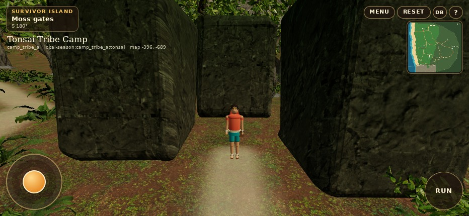
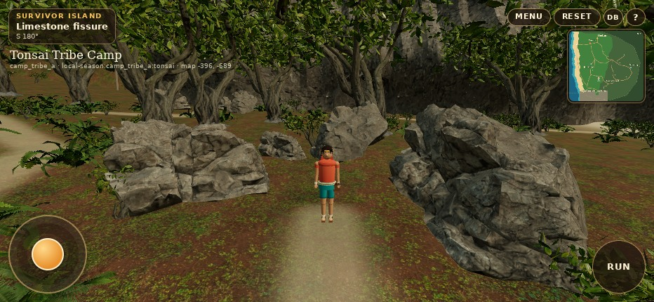
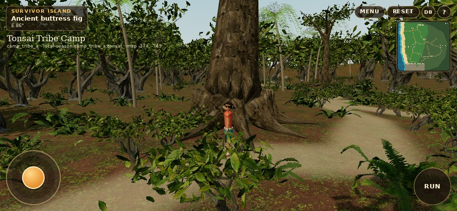
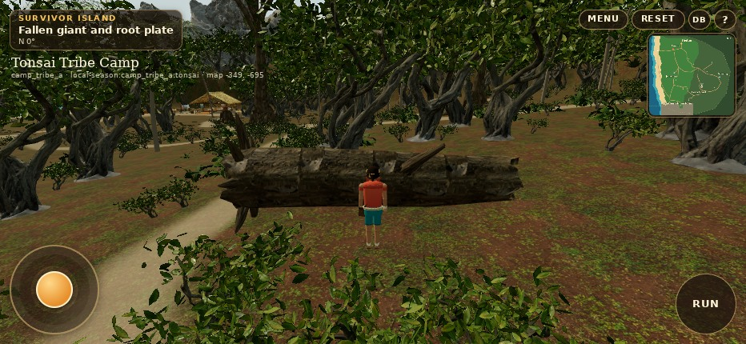
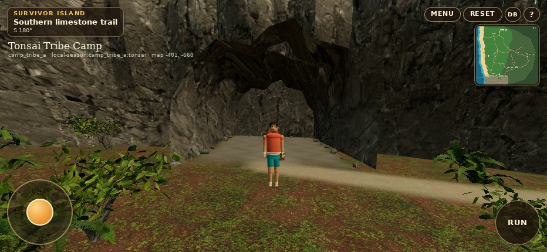
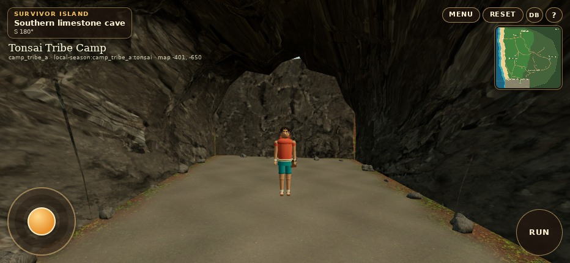

# Genuine WebGL comparisons

Before: merged PR16 `fd2c39d`. After: this draft. Both are minified production builds with the same native Player boom, exact player positions, yaw, pitch, quality, viewport **932 × 430**, DPR1. ANGLE SwiftShader Chromium, desktop touch emulation. No generated artwork or offline beauty renders. Originals are retained at full captured resolution. Portrait/physical Safari are separate from these landscape comparison views.

The baseline was built before implementation and retained independently. The QA read bridge is inserted only by the test build. The gallery advances the real Player/camera at fixed 60 Hz to frame a reproducible shot; it teleports only for gallery placement. Continuous walking evidence is separately recorded in [the expedition](evidence/expedition/report.json).

| View | High before | High after | Mobile low before | Mobile low after |
|---|---|---|---|---|
| Former Moss Gates → limestone fissure | [Before](evidence/before/high-moss-replacement.jpg) | [After](evidence/after/high-moss-replacement.jpg) | [Before](evidence/before/low-moss-replacement.jpg) | [After](evidence/after/low-moss-replacement.jpg) |
| Southern limestone base | [Before](evidence/before/high-cliff-base.jpg) | [After](evidence/after/high-cliff-base.jpg) | [Before](evidence/before/low-cliff-base.jpg) | [After](evidence/after/low-cliff-base.jpg) |
| Cave entrance | [Before](evidence/before/high-cave-entrance.jpg) | [After](evidence/after/high-cave-entrance.jpg) | [Before](evidence/before/low-cave-entrance.jpg) | [After](evidence/after/low-cave-entrance.jpg) |
| Cave interior | [Before](evidence/before/high-cave-interior.jpg) | [After](evidence/after/high-cave-interior.jpg) | [Before](evidence/before/low-cave-interior.jpg) | [After](evidence/after/low-cave-interior.jpg) |
| Ancient fig | [Before](evidence/before/high-ancient-tree.jpg) | [After](evidence/after/high-ancient-tree.jpg) | [Before](evidence/before/low-ancient-tree.jpg) | [After](evidence/after/low-ancient-tree.jpg) |
| Fallen giant | [Before](evidence/before/high-fallen-giant.jpg) | [After](evidence/after/high-fallen-giant.jpg) | [Before](evidence/before/low-fallen-giant.jpg) | [After](evidence/after/low-fallen-giant.jpg) |
| Intertwined roots | [Before](evidence/before/high-intertwined-roots.jpg) | [After](evidence/after/high-intertwined-roots.jpg) | [Before](evidence/before/low-intertwined-roots.jpg) | [After](evidence/after/low-intertwined-roots.jpg) |
| Hollow stump | [Before](evidence/before/high-hollow-stump.jpg) | [After](evidence/after/high-hollow-stump.jpg) | [Before](evidence/before/low-hollow-stump.jpg) | [After](evidence/after/low-hollow-stump.jpg) |
| Strangler fig and stone | [Before](evidence/before/high-strangler-stone.jpg) | [After](evidence/after/high-strangler-stone.jpg) | [Before](evidence/before/low-strangler-stone.jpg) | [After](evidence/after/low-strangler-stone.jpg) |
| Jungle trail | [Before](evidence/before/high-jungle-trail.jpg) | [After](evidence/after/high-jungle-trail.jpg) | [Before](evidence/before/low-jungle-trail.jpg) | [After](evidence/after/low-jungle-trail.jpg) |
| Freshwater spring | [Before](evidence/before/high-freshwater.jpg) | [After](evidence/after/high-freshwater.jpg) | [Before](evidence/before/low-freshwater.jpg) | [After](evidence/after/low-freshwater.jpg) |
| Rock alcove | [Before](evidence/before/high-rock-alcove.jpg) | [After](evidence/after/high-rock-alcove.jpg) | [Before](evidence/before/low-rock-alcove.jpg) | [After](evidence/after/low-rock-alcove.jpg) |
| Coastal camp | [Before](evidence/before/high-coastal-camp.jpg) | [After](evidence/after/high-coastal-camp.jpg) | [Before](evidence/before/low-coastal-camp.jpg) | [After](evidence/after/low-coastal-camp.jpg) |
| Inland forest | [Before](evidence/before/high-dense-forest.jpg) | [After](evidence/after/high-dense-forest.jpg) | [Before](evidence/before/low-dense-forest.jpg) | [After](evidence/after/low-dense-forest.jpg) |

## Limestone passage

## Signature wood

## Cave

Camera positions and CPU observations are retained in the raw [before](evidence/before/report.json) and [after](evidence/after/report.json) reports. This is evidence of the implemented scene, not physical iPhone performance certification.
