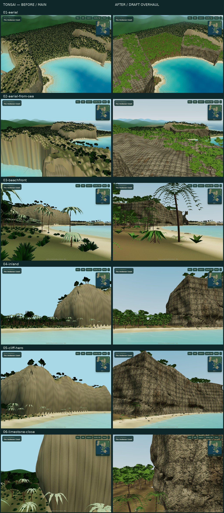
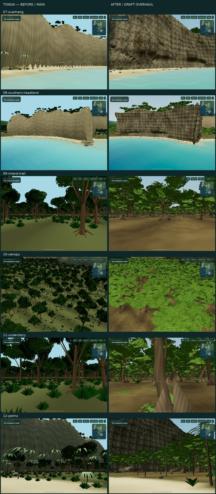
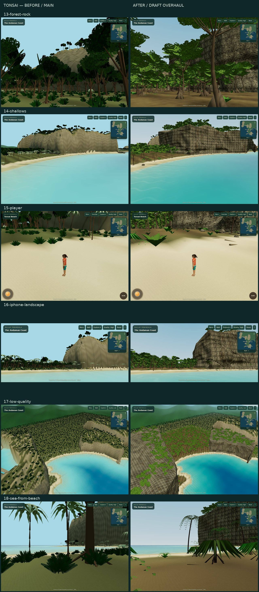

# Tonsai — actual in-game comparison gallery

All frames are real WebGL screenshots. Left is main `24c7c9d`; right is the implemented draft. No Blender-only renders or generated concept frames are presented as game evidence. Camera parameters are in [`tonsai-views.json`](../../../artifacts/survivor-camp-prototype/scripts/tonsai-views.json). Daylight remains static; materials, daylight balance, sky and water intentionally change. The player pair uses the same spawn / normal gameplay camera.

[Honest art assessment and remaining gaps](../REPORT.md#visual-first-process-and-review)

## Full-size frames

| View | Before | After |
| --- | --- | --- |
| 01-aerial | [Open](before/01-aerial.jpg) | [Open](after/01-aerial.jpg) |
| 02-aerial-from-sea | [Open](before/02-aerial-from-sea.jpg) | [Open](after/02-aerial-from-sea.jpg) |
| 03-beachfront | [Open](before/03-beachfront.jpg) | [Open](after/03-beachfront.jpg) |
| 04-inland | [Open](before/04-inland.jpg) | [Open](after/04-inland.jpg) |
| 05-cliff-hero | [Open](before/05-cliff-hero.jpg) | [Open](after/05-cliff-hero.jpg) |
| 06-limestone-close | [Open](before/06-limestone-close.jpg) | [Open](after/06-limestone-close.jpg) |
| 07-overhang | [Open](before/07-overhang.jpg) | [Open](after/07-overhang.jpg) |
| 08-southern-headland | [Open](before/08-southern-headland.jpg) | [Open](after/08-southern-headland.jpg) |
| 09-inland-trail | [Open](before/09-inland-trail.jpg) | [Open](after/09-inland-trail.jpg) |
| 10-canopy | [Open](before/10-canopy.jpg) | [Open](after/10-canopy.jpg) |
| 11-understory | [Open](before/11-understory.jpg) | [Open](after/11-understory.jpg) |
| 12-palms | [Open](before/12-palms.jpg) | [Open](after/12-palms.jpg) |
| 13-forest-rock | [Open](before/13-forest-rock.jpg) | [Open](after/13-forest-rock.jpg) |
| 14-shallows | [Open](before/14-shallows.jpg) | [Open](after/14-shallows.jpg) |
| 15-player | [Open](before/15-player.jpg) | [Open](after/15-player.jpg) |
| 16-iphone-landscape | [Open](before/16-iphone-landscape.jpg) | [Open](after/16-iphone-landscape.jpg) |
| 17-low-quality | [Open](before/17-low-quality.jpg) | [Open](after/17-low-quality.jpg) |
| 18-sea-from-beach | [Open](before/18-sea-from-beach.jpg) | [Open](after/18-sea-from-beach.jpg) |

## Additional regression evidence

- [Expanded live map](after/21-expanded-live-map.jpg)
- [Actual movement in Tonsai](gameplay-tonsai.jpg)
- [Existing camp](regression-camp.jpg)
- [Existing Tribal Council](regression-tribal.jpg)
- [Gameplay, touch events and disposal results](gameplay-report.json)
- [Blocked asset results](loading-report.json)
