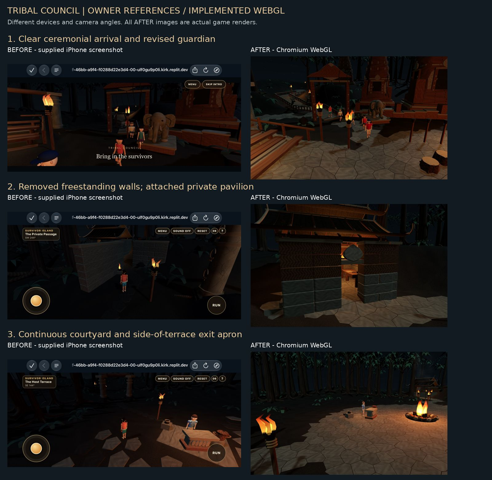

# Tribal Council pathways and cinematic polish

## Scope and verdict

Implemented on latest main `82a3c84358ddf5c995df7d9bccffaaaf26d612b3` (merged PR #5, which superseded the brief's last confirmed PR #4). Mandatory pathway defects are corrected and tested. This is a substantial environment and presentation improvement, **not a claim of photorealistic characters or physical iPhone Safari certification**. No merge or deployment was performed.



## Canonical architecture and corrections

- `layout.ts` remains the metre-based source for `ARRIVAL`, `VOTING_PATH`, `JURY_PATH`, `EXIT_PATH`, terrain elevation, staging anchors, scenery footprints and collision. Existing map orientation and intimate staggered seating are retained. `architecture.ts` builds merged scenery and camera proxies from those descriptors; `thaiArchitecture.ts` owns sculptural forms. `intro.ts` and `elimination.ts` consume those routes. There is no second coordinate system.
- The offending arrival torch was generated by the old `p.x - 1.7` offset at the diagonal route vertex near `(-25,-21)`. The old post at `(-26.7,-21)` lies only about 1.08m from the route. `offsetPath` now places practicals relative to path direction, with mitered railing joins at stair turns. `corridorClear` reserves 2.2m plus the whole prop footprint. `PRACTICALS` supplies visible torch geometry, flame positions, movement solids and camera heights. The western elephant is moved clear of the procession and has a matching physical footprint. Tree roots and understory use the same clearance rule.
- Deleted both `privacy-wall` and `privacy-wall-west` from geometry **and** collision. The pavilion retains its own attached back/side/return walls, with masonry below, timber above, enclosed gables, roof rafters, perimeter supports and a framed east doorway. The writing station stays inside the room. No replacement freestanding screen was introduced. Council-to-parchment sightline tests cover every seat, Jeff, and four corners of the writing surface.
- `EXIT_PATH[0]` is now `EXIT_ORIGIN = (10.8,0.6)`, on the open north/east apron beside Jeff's terrace, interpreted from screenshot 3. The old `(9,6.5) -> (16,8) -> (21,12)` route is removed. The new route curves through `(16,-0.5)` and `(21,2.5)` into the jungle. Portal piers, torches, paving, foliage exclusions, movement, location labels and camera anchors follow it. The torch-snuff approach is separate from the receiver's collision footprint.
- Replaced scattered pentagonal stepping stones and the separate host slab with continuous mortared Voronoi flagstones. Every top vertex samples `tribalHeight`, including terrace grades, booth floor and all circulation routes. The original physical stairs and bridge retain ownership of their treads and deck. Earth is recessed below pavement; joints, stone variation, irregular edges and embedded terrace brickwork provide weathering without floating stones.
- Refined Asian elephant shoulder/head/ear proportions, tusk asymmetry and shallow eye/fold details. Retained the authored recessed prangs, bell chedi and open skyline. Added attached pavilion gables and rafters rather than another canopy. Increased cool sky fill and moonlight, with two localized warm route fills baked into vertex colors. Only the existing directional light casts shadows; there is no per-torch dynamic light. The six point lights match the baseline count. Brighter layered foliage and fern-like understory vary the jungle while retaining spatial batching.
- Smaller heads, inset player eyes, rough skin/clothing shading, varied idle phases, more relaxed seated legs and arm sway improve the existing character rigs without changing identity or movement interfaces. Arrival speed is reduced to 2.15m/s. The arrival camera fits the actual moving cast at the current aspect ratio instead of tracking a fixed point that crops the trailing player.
- The contextual **Rehearse the last walk** action near Jeff stages approach, a snuff hold with extinguished carried flame, and departure along the new route. It returns to seated exploration and changes no season result. This is a presentation rehearsal, not a newly implemented voting simulation. The original repository was read at `cf894e578d77fce1e588d793dfc8d14f61ec7628`; its `TribalCouncilView` `snuff` / `tribal-exit` beats and resolved elimination remain the future adapter authority. Its worktree is unchanged.

## Verification

| Acceptance area | Result / evidence |
|---|---|
| Arrival torch and scenery clearance | Pass: full route in both directions, protected footprints, and lateral group-width samples |
| Removed voting barriers | Pass: neither ID remains; visible approach inspected in WebGL |
| Voting approach and private interior | Pass: real Player traversal both ways; eye-ray privacy tests; interior and doorway captures |
| Side exit and old-route retirement | Pass: canonical origin, five actors' approach/hold/departure continuity, production rehearsal and route traversal |
| Jeff, fire and staggered seating | Pass: clear body separation, no host flanking pillars, seated and host-eye captures |
| Skyline, gallery, naga stairs and bridge | Pass: genuine rendered captures; jury remains unoccupied |
| Surface alignment and grounding | Pass: every pavement vertex checked; real controller remains grounded on all four routes |
| Intro, skip, stand, reset and reentry | Pass: production UI and scene transitions |
| Joystick, touch release, run, orbit and audio | Pass: browser controls and movement; audio gesture start/stop |
| Camera obstruction | Pass: booth orbit sweep and route camera checks; no trapped lens |
| 375×812, 430×932, 844×390, 1280×800 | Pass: rendering, HUD captures, and all five actors inside the arrival frustum at four points in each viewport |
| Camp regression | Pass: six browser checks, 14 captures, no runtime errors; production simulation snapshots unchanged |

27 automated tests pass, including 256 directed camp routes and 22,978 camp travel frames. App typecheck, production build and island world checks pass. The build retains the existing large main-chunk warning. Tribal browser run: 67 checks, 32 screenshots, zero runtime/console errors. Movement uses accelerated fixed frames; screenshot draws and separate GPU timings are real WebGL work.

Evidence: [Tribal browser results](polish-evidence/browser-certification.json), [camp results](polish-evidence/camp/browser-certification.json), [unit tests](polish-evidence/unit-tests.txt), [build](polish-evidence/build.txt), [island collision checks](polish-evidence/world-check.txt).

## Rendering findings

| Viewport | Draw calls: base → head | Triangles: base → head | Median render ms: base → head |
|---|---:|---:|---:|
| 375×812 | 122 → 124 | 267,564 → 287,385 | 453.5 → 527.7 |
| 430×932 | 122 → 124 | 267,564 → 287,385 | 532.5 → 611.8 |
| 844×390 | 191 → 188 | 359,332 → 370,735 | 718.6 → 827.9 |
| 1280×800 | 179 → 179 | 352,018 → 359,417 | 1644.2 → 1391.0 |

The denser understory was reduced from 7×6 paired fronds with 7 leaf segments to 5×4 with 2 segments; two added dynamic route lights were replaced with static vertex fill. The final counts show the remaining cost of continuous paving and varied foliage. Physical-device impact is still unmeasured.

The benchmark uses one identical fixed camera, viewport, device pixel ratio and 8 synchronous GPU/readback samples per viewport on baseline and head. Shadows refresh on samples 0 and 5. These are short Chromium/SwiftShader software-renderer timings, **not iPhone frame rates or thermal measurements**. An intermediate harness run exposed a camera-yaw reset after the framing check. The final harness explicitly restores the fixed measurement camera before timing; only that corrected run is included here. See [head benchmark](polish-evidence/render-benchmark.json) and [baseline benchmark](polish-evidence/baseline-render-benchmark.json).

Reproduce from `artifacts/survivor-camp-prototype`:

```sh
pnpm typecheck
pnpm test
PORT=5176 BASE_PATH=/ pnpm build
pnpm qa:tribal
node scripts/tribal-performance.mjs
pnpm qa:living-camp
```

Set `CAMP_CHROMIUM` for a local browser executable; `TRIBAL_EVIDENCE` / `CAMP_EVIDENCE` optionally redirect outputs. CI now retains the new evidence directory. No new runtime dependency is required.

## Limits and remaining work

Physical iPhone Safari, sustained frame pacing, memory pressure and thermal behavior still need device review. The supplied iPhone images and new desktop/landscape captures use different lenses and HUD framing; the comparison is architectural, not a pixel-matched benchmark. Characters remain procedural and stylized, without production facial animation, eye tracking, cloth or hand-to-prop IK. Snuffing is a rehearsal with approximate hand motion; a live season-result adapter, carried torch retrieval from each station, voiced dialogue, authored reactions and jury-phase population are future work. Vegetation, stone and architecture are improved procedural assets; bespoke scanned/sculpted hero assets would be a further fidelity pass. The complete ancient-sanctuary art ambition is therefore not represented as finished photorealistic production art.

Architectural reference: [UNESCO Ayutthaya](https://whc.unesco.org/en/list/576/) for monumental prangs and ruin composition, and [UNESCO Wat Phutthaisawan field report](https://www.unesco.org/en/articles/unesco-field-report-demystifying-ancient-ayutthaya?hub=758) for distinct prang/stupa silhouettes. This is a fictional Thai-inspired sanctuary, not a reconstruction of a named historical temple.
