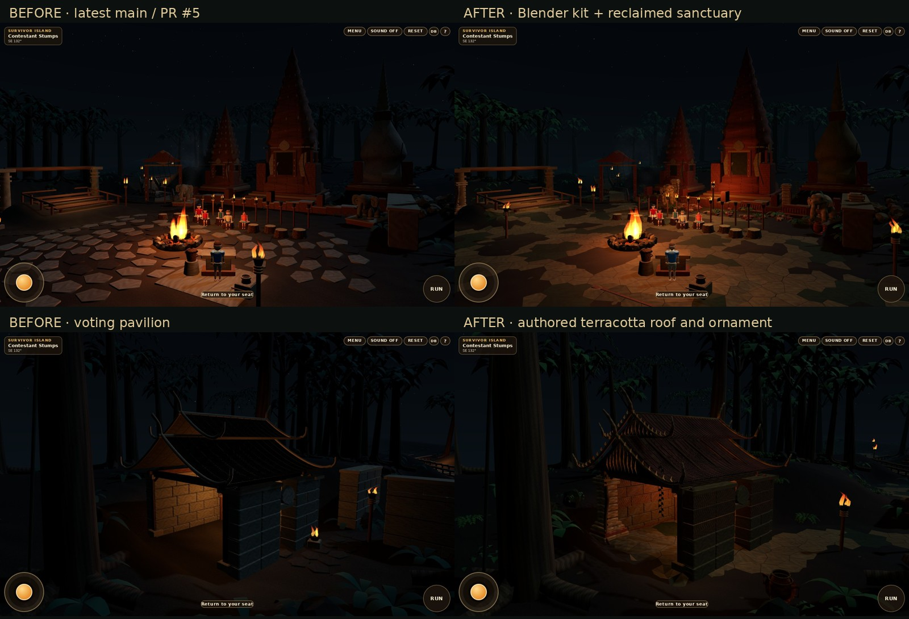

# Actual in-game WebGL evidence

All JPEGs here are captures of the implemented browser game. No Blender renders, concept art or generated illustrations are used.

| View | Capture |
| --- | --- |
| Arrival | [arrival](arrival.jpg) |
| Sanctuary | [wide council](sanctuary.jpg) |
| Contestants | [seating](seating.jpg) |
| Host | [Jeff](jeff.jpg) |
| Voting structure | [authored roof](voting-roof.jpg), [booth interior](voting-interior.jpg) |
| Voting route | [approach](voting-approach.jpg) |
| Torch snuff | [ceremony rehearsal](gameplay/16-torch-snuff-rehearsal.jpg) |
| Departure | [side exit](exit.jpg), [procession](gameplay/17-side-exit-procession.jpg) |
| Sculpture | [elephant guardian](guardian.jpg) |
| Mobile viewports | [375×812](mobile-375.jpg), [430×932](mobile-430.jpg), [844×390](mobile-844.jpg) |
| Fallback | [low quality sanctuary](low/sanctuary.jpg), [low quality roof](low/voting-roof.jpg) |

`before/` captures latest main `82a3c84`; the wide and roof camera positions/targets match the implemented captures. The guardian was subsequently moved to protect the arrival corridor, so its close-up is not a fixed-frustum performance comparison.

- [Asset review / renderer counters and software readbacks](asset-review.json)
- [Baseline counters](before/asset-review.json)
- [Low-quality counters](low/asset-review.json)
- [Asset loading, deliberate 404 fallback and reentry](loading-qa.json)
- [Exported binary budgets](asset-budgets.json)
- [67 gameplay checks and 32 captures](gameplay/browser-certification.json)
- [Camp regression](camp/browser-certification.json)
- [Certification and practical limits](../BLENDER-CERTIFICATION.md)

Chrome Headless Shell 142 / SwiftShader, Linux. Viewports and touch are emulated; no physical iPhone Safari or thermal/FPS claim.
